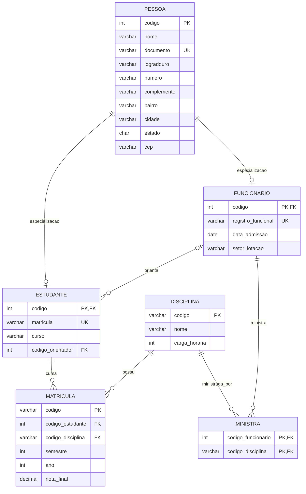

# 3. Universidade comunitária

Uma universidade cadastra pessoas com nome, documento e endereço, composto por logradouro, número, complemento, bairro, cidade, estado e CEP. Toda pessoa cadastrada é estudante, funcionária ou ambas as coisas. Estudantes possuem número de matrícula e curso; funcionários possuem registro funcional, data de admissão e setor de lotação. Um funcionário pode orientar vários estudantes, mas cada estudante tem no máximo um orientador, que deve ser funcionário. A universidade oferece disciplinas identificadas por código, nome e carga horária. Estudantes podem cursar várias disciplinas e cada disciplina pode ter vários estudantes; para cada matrícula em disciplina são guardados semestre, ano e nota final. Funcionários podem ministrar disciplinas, e uma disciplina pode ser ministrada por mais de um funcionário.

Modele Pessoa com especialização total e sobreposta (compartilhada) em Estudante e Funcionário. Considere que uma pessoa pode estar nas duas subentidades. Represente o autorrelacionamento de orientação com os papéis de orientador e orientado, o endereço composto e os relacionamentos acadêmicos.

## Diagrama Entidade Relacionamento



# DDL - Data Definition Language

## 1. Exclusão das tabelas existentes

Executar somente quando for necessário recriar a estrutura do banco.

```
-- Tabelas dependentes
DROP TABLE matricula CASCADE CONSTRAINTS;
DROP TABLE ministra CASCADE CONSTRAINTS;
DROP TABLE estudante CASCADE CONSTRAINTS;
DROP TABLE funcionario CASCADE CONSTRAINTS;

-- Tabelas principais
DROP TABLE disciplina CASCADE CONSTRAINTS;
DROP TABLE pessoa CASCADE CONSTRAINTS;

-- Sequence antiga
DROP SEQUENCE seq_pessoa;
```

Atenção: os comandos `DROP TABLE` excluem definitivamente os registros existentes. As triggers vinculadas às tabelas também são removidas automaticamente.

## 2. Criação da tabela PESSOA

Tabela principal que armazena os dados comuns de estudantes e funcionários.

```
CREATE TABLE pessoa (
    codigo NUMBER(10) PRIMARY KEY,
    nome VARCHAR2(100) NOT NULL,
    documento VARCHAR2(20) NOT NULL UNIQUE,
    logradouro VARCHAR2(100),
    numero VARCHAR2(10),
    complemento VARCHAR2(50),
    bairro VARCHAR2(50),
    cidade VARCHAR2(50),
    estado CHAR(2),
    cep VARCHAR2(9)
);
```

## 3. Criação da tabela FUNCIONARIO

Especialização de `PESSOA`. O campo `codigo` funciona simultaneamente como chave primária e chave estrangeira.

```
CREATE TABLE funcionario (
    codigo NUMBER(10) PRIMARY KEY,
    registro_funcional VARCHAR2(20) NOT NULL UNIQUE,
    data_admissao DATE NOT NULL,
    setor_lotacao VARCHAR2(100) NOT NULL,

    CONSTRAINT fk_funcionario_pessoa
        FOREIGN KEY (codigo)
        REFERENCES pessoa(codigo)
);
```

## 4. Criação da tabela ESTUDANTE

Especialização de `PESSOA`, com matrícula alfanumérica e relacionamento de orientação acadêmica.

```
CREATE TABLE estudante (
    codigo NUMBER(10) PRIMARY KEY,
    matricula VARCHAR2(20) NOT NULL UNIQUE,
    curso VARCHAR2(100) NOT NULL,
    codigo_orientador NUMBER(10),

    CONSTRAINT fk_estudante_pessoa
        FOREIGN KEY (codigo)
        REFERENCES pessoa(codigo),

    CONSTRAINT fk_estudante_orientador
        FOREIGN KEY (codigo_orientador)
        REFERENCES funcionario(codigo)
);
```

O campo `codigo_orientador` permite `NULL`, representando estudantes que ainda não possuem orientador.

## 5. Criação da tabela DISCIPLINA

O código da disciplina será alfanumérico, permitindo identificadores como `BD001`, `ALG001` e `DEV001`.

```
CREATE TABLE disciplina (
    codigo VARCHAR2(20) PRIMARY KEY,
    nome VARCHAR2(100) NOT NULL,
    carga_horaria NUMBER(4) NOT NULL
);
```

## 6. Criação da tabela MATRICULA (N:M)

Tabela associativa que representa o relacionamento entre estudantes e disciplinas.

```
CREATE TABLE matricula (
    codigo VARCHAR2(20) PRIMARY KEY,
    codigo_estudante NUMBER(10) NOT NULL,
    codigo_disciplina VARCHAR2(20) NOT NULL,
    semestre NUMBER(1) NOT NULL,
    ano NUMBER(4) NOT NULL,
    nota_final NUMBER(4,2),

    CONSTRAINT uk_matricula_disciplina
        UNIQUE (
            codigo_estudante,
            codigo_disciplina,
            semestre,
            ano
        ),

    CONSTRAINT fk_md_estudante
        FOREIGN KEY (codigo_estudante)
        REFERENCES estudante(codigo),

    CONSTRAINT fk_md_disciplina
        FOREIGN KEY (codigo_disciplina)
        REFERENCES disciplina(codigo),

    CONSTRAINT ck_md_semestre
        CHECK (semestre IN (1, 2)),

    CONSTRAINT ck_md_nota
        CHECK (nota_final BETWEEN 0 AND 10)
);
```

A restrição `UNIQUE` composta impede que um estudante seja matriculado duas vezes na mesma disciplina, no mesmo semestre e ano.

## 7. Criação da tabela MINISTRA (N:M)

Tabela associativa que representa o relacionamento entre funcionários e disciplinas.

```
CREATE TABLE ministra (
    codigo_funcionario NUMBER(10) NOT NULL,
    codigo_disciplina VARCHAR2(20) NOT NULL,

    CONSTRAINT pk_ministra
        PRIMARY KEY (
            codigo_funcionario,
            codigo_disciplina
        ),

    CONSTRAINT fk_ministra_funcionario
        FOREIGN KEY (codigo_funcionario)
        REFERENCES funcionario(codigo),

    CONSTRAINT fk_ministra_disciplina
        FOREIGN KEY (codigo_disciplina)
        REFERENCES disciplina(codigo)
);
```

## 8. Criação da SEQUENCE – PESSOA

A sequence será responsável pela geração automática dos códigos da tabela `PESSOA`.

```
CREATE SEQUENCE seq_pessoa
    START WITH 1
    INCREMENT BY 1
    NOCACHE
    NOCYCLE;
```

## 9. Criação da TRIGGER – PESSOA

A trigger será executada antes de cada inserção na tabela `PESSOA`.

```
CREATE OR REPLACE TRIGGER trg_seq_pessoa
BEFORE INSERT ON pessoa
FOR EACH ROW
BEGIN
    IF :NEW.codigo IS NULL THEN
        SELECT seq_pessoa.NEXTVAL
        INTO :NEW.codigo
        FROM dual;
    END IF;
END;
/
```

A trigger somente atribuirá um código automaticamente quando o campo `codigo` não for informado.

## 10. Exemplos de ALTER TABLE

Os comandos abaixo são exemplos didáticos de alterações estruturais. Não devem ser executados automaticamente após a criação das tabelas, pois algumas operações dependem da existência de nomes anteriores.

### Renomear uma tabela

```
ALTER TABLE matricula_disciplina
RENAME TO matricula;
```

### Renomear uma coluna

```
ALTER TABLE matricula
RENAME COLUMN codigo_matricula TO codigo;
```

### Renomear uma constraint

```
ALTER TABLE matricula
RENAME CONSTRAINT uk_matricula_disciplina
TO uq_matricula_disciplina;
```

## DTL – Data Transaction Language

A DTL (Linguagem de Controle de Transações) permite confirmar ou desfazer alterações realizadas no banco de dados.

### 1. COMMIT

Confirma definitivamente as alterações realizadas na transação.

```
COMMIT;
```

### 2. ROLLBACK

Desfaz as alterações realizadas desde o último `COMMIT` ou `ROLLBACK`.

```
ROLLBACK;
```

### 3. SAVEPOINT

Cria um ponto de restauração dentro de uma transação.

```
SAVEPOINT ponto1;
```

### 4. ROLLBACK TO SAVEPOINT

Desfaz as alterações realizadas após um determinado ponto de restauração.

```
ROLLBACK TO ponto1;
```

### 5. Exemplo completo

```
-- Inserir uma pessoa
INSERT INTO pessoa (nome, documento)
VALUES ('João Silva', '123.456.789-01');

-- Criar ponto de restauração
SAVEPOINT ponto1;

-- Inserir outra pessoa
INSERT INTO pessoa (nome, documento)
VALUES ('Maria Souza', '987.654.321-02');

-- Desfazer somente a segunda inserção
ROLLBACK TO ponto1;

-- Confirmar a primeira inserção
COMMIT;
```

Observação: no Oracle 11g, os comandos DDL, como `CREATE`, `ALTER`, `DROP` e `TRUNCATE`, provocam `COMMIT` implícito e não podem ser desfeitos por `ROLLBACK`. Já operações DML, como `INSERT`, `UPDATE` e `DELETE`, podem ser desfeitas enquanto não forem confirmadas.

## DML - Data Manipulation Language

```sql
-- ============================================================
-- 1. PESSOA (30 registros)
-- ============================================================

INSERT INTO pessoa (nome, documento, logradouro, numero, complemento, bairro, cidade, estado, cep)
VALUES ('Agatha Cristina', '123.456.789-10', 'Rua das Margaridas', '123', 'APT 1', 'Centro', 'Sorocaba', 'SP', '12345-678');

INSERT INTO pessoa (nome, documento, logradouro, numero, complemento, bairro, cidade, estado, cep)
VALUES ('Ana Oliveira', '111.111.111-11', 'Rua das Flores', '100', 'Casa', 'Centro', 'Sorocaba', 'SP', '18000-000');

INSERT INTO pessoa (nome, documento, logradouro, numero, complemento, bairro, cidade, estado, cep)
VALUES ('Carlos Santos', '222.222.222-22', 'Rua das Palmeiras', '200', NULL, 'Jardim Europa', 'Sorocaba', 'SP', '18001-000');

INSERT INTO pessoa (nome, documento, logradouro, numero, complemento, bairro, cidade, estado, cep)
VALUES ('Mariana Costa', '333.333.333-33', 'Av. Brasil', '300', 'Apto 12', 'Centro', 'Sorocaba', 'SP', '18002-000');

INSERT INTO pessoa (nome, documento, logradouro, numero, complemento, bairro, cidade, estado, cep)
VALUES ('Pedro Almeida', '444.444.444-44', 'Rua Azul', '400', NULL, 'Vila Nova', 'Sorocaba', 'SP', '18003-000');

INSERT INTO pessoa (nome, documento, logradouro, numero, complemento, bairro, cidade, estado, cep)
VALUES ('Julia Martins', '555.555.555-55', 'Rua Verde', '500', 'Casa 2', 'Centro', 'Sorocaba', 'SP', '18004-000');

INSERT INTO pessoa (nome, documento, logradouro, numero, complemento, bairro, cidade, estado, cep)
VALUES ('Maria Silva', '987.654.321-00', NULL, NULL, NULL, NULL, 'Sorocaba', 'SP', NULL);

INSERT INTO pessoa (nome, documento, logradouro, numero, complemento, bairro, cidade, estado, cep)
VALUES ('José Carlos', '456.123.789-00', NULL, NULL, NULL, NULL, 'Sorocaba', 'SP', NULL);

INSERT INTO pessoa (nome, documento, logradouro, numero, complemento, bairro, cidade, estado, cep)
VALUES ('Gabriel Felipe', '901.123.789-00', NULL, NULL, NULL, NULL, 'Sorocaba', 'SP', NULL);

INSERT INTO pessoa (nome, documento, logradouro, numero, complemento, bairro, cidade, estado, cep)
VALUES ('Samuel', '123.456.789-00', 'Rua X de Novembro', '266', NULL, 'Alvorada', 'São Roque', 'SP', '12345-456');

INSERT INTO pessoa (nome, documento, logradouro, numero, complemento, bairro, cidade, estado, cep)
VALUES ('Miguel', '987.654.321-01', 'R. Alan Kardec', '91', NULL, 'Jardim Boa Vista', 'São Roque', 'SP', '12345-456');

INSERT INTO pessoa (nome, documento, logradouro, numero, complemento, bairro, cidade, estado, cep)
VALUES ('Thomas', '123.789.457-00', 'R. das Açucenas', '241', 'Portão Branco', 'Vila Amaral', 'São Roque', 'SP', '12345-456');

INSERT INTO pessoa (nome, documento, logradouro, numero, complemento, bairro, cidade, estado, cep)
VALUES ('Roberto', '123.123.789-66', 'R. Antenor Pereira', '121', NULL, 'Jardim Cruzeiro Gleba B.', 'Mairinque', 'SP', '12546-231');

INSERT INTO pessoa (nome, documento, logradouro, numero, complemento, bairro, cidade, estado, cep)
VALUES ('Arthur', '123.654.789-09', 'Tv. Cecília de Paula Arruda', '56', NULL, 'Jardim Rene', 'São Roque', 'SP', '12345-111');

INSERT INTO pessoa (nome, documento, logradouro, numero, complemento, bairro, cidade, estado, cep)
VALUES ('Henrique', '198.456.789-88', 'Rua X de Novembro', '266', NULL, 'Alvorada', 'São Roque', 'SP', '12345-456');

INSERT INTO pessoa (nome, documento, logradouro, numero, complemento, bairro, cidade, estado, cep)
VALUES ('Beatriz Lima', '900.000.016-00', 'Rua Universitaria 16', '160', NULL, 'Centro', 'Sorocaba', 'SP', '18000-016');

INSERT INTO pessoa (nome, documento, logradouro, numero, complemento, bairro, cidade, estado, cep)
VALUES ('Camila Rocha', '900.000.017-00', 'Rua Universitaria 17', '170', NULL, 'Centro', 'Sorocaba', 'SP', '18000-017');

INSERT INTO pessoa (nome, documento, logradouro, numero, complemento, bairro, cidade, estado, cep)
VALUES ('Daniel Pereira', '900.000.018-00', 'Rua Universitaria 18', '180', NULL, 'Centro', 'Sorocaba', 'SP', '18000-018');

INSERT INTO pessoa (nome, documento, logradouro, numero, complemento, bairro, cidade, estado, cep)
VALUES ('Eduarda Fernandes', '900.000.019-00', 'Rua Universitaria 19', '190', NULL, 'Centro', 'Sorocaba', 'SP', '18000-019');

INSERT INTO pessoa (nome, documento, logradouro, numero, complemento, bairro, cidade, estado, cep)
VALUES ('Felipe Ribeiro', '900.000.020-00', 'Rua Universitaria 20', '200', NULL, 'Centro', 'Sorocaba', 'SP', '18000-020');

INSERT INTO pessoa (nome, documento, logradouro, numero, complemento, bairro, cidade, estado, cep)
VALUES ('Giovana Alves', '900.000.021-00', 'Rua Universitaria 21', '210', NULL, 'Centro', 'Sorocaba', 'SP', '18000-021');

INSERT INTO pessoa (nome, documento, logradouro, numero, complemento, bairro, cidade, estado, cep)
VALUES ('Helena Castro', '900.000.022-00', 'Rua Universitaria 22', '220', NULL, 'Centro', 'Sorocaba', 'SP', '18000-022');

INSERT INTO pessoa (nome, documento, logradouro, numero, complemento, bairro, cidade, estado, cep)
VALUES ('Igor Nascimento', '900.000.023-00', 'Rua Universitaria 23', '230', NULL, 'Centro', 'Sorocaba', 'SP', '18000-023');

INSERT INTO pessoa (nome, documento, logradouro, numero, complemento, bairro, cidade, estado, cep)
VALUES ('Larissa Gomes', '900.000.024-00', 'Rua Universitaria 24', '240', NULL, 'Centro', 'Sorocaba', 'SP', '18000-024');

INSERT INTO pessoa (nome, documento, logradouro, numero, complemento, bairro, cidade, estado, cep)
VALUES ('Leonardo Barbosa', '900.000.025-00', 'Rua Universitaria 25', '250', NULL, 'Centro', 'Sorocaba', 'SP', '18000-025');

INSERT INTO pessoa (nome, documento, logradouro, numero, complemento, bairro, cidade, estado, cep)
VALUES ('Luiza Mendes', '900.000.026-00', 'Rua Universitaria 26', '260', NULL, 'Centro', 'Sorocaba', 'SP', '18000-026');

INSERT INTO pessoa (nome, documento, logradouro, numero, complemento, bairro, cidade, estado, cep)
VALUES ('Matheus Oliveira', '900.000.027-00', 'Rua Universitaria 27', '270', NULL, 'Centro', 'Sorocaba', 'SP', '18000-027');

INSERT INTO pessoa (nome, documento, logradouro, numero, complemento, bairro, cidade, estado, cep)
VALUES ('Natalia Ferreira', '900.000.028-00', 'Rua Universitaria 28', '280', NULL, 'Centro', 'Sorocaba', 'SP', '18000-028');

INSERT INTO pessoa (nome, documento, logradouro, numero, complemento, bairro, cidade, estado, cep)
VALUES ('Rafael Costa', '900.000.029-00', 'Rua Universitaria 29', '290', NULL, 'Centro', 'Sorocaba', 'SP', '18000-029');

INSERT INTO pessoa (nome, documento, logradouro, numero, complemento, bairro, cidade, estado, cep)
VALUES ('Sofia Almeida', '900.000.030-00', 'Rua Universitaria 30', '300', NULL, 'Centro', 'Sorocaba', 'SP', '18000-030');

-- ============================================================
-- 2. FUNCIONARIO (15 registros)
-- ============================================================

INSERT INTO funcionario (codigo, registro_funcional, data_admissao, setor_lotacao)
SELECT codigo, 'F001', DATE '2015-01-10', 'Tecnologia'
FROM pessoa WHERE documento = '123.456.789-10';

INSERT INTO funcionario (codigo, registro_funcional, data_admissao, setor_lotacao)
SELECT codigo, 'F002', DATE '2016-02-11', 'Secretaria'
FROM pessoa WHERE documento = '111.111.111-11';

INSERT INTO funcionario (codigo, registro_funcional, data_admissao, setor_lotacao)
SELECT codigo, 'F003', DATE '2017-03-12', 'Biblioteca'
FROM pessoa WHERE documento = '222.222.222-22';

INSERT INTO funcionario (codigo, registro_funcional, data_admissao, setor_lotacao)
SELECT codigo, 'F004', DATE '2018-04-13', 'Coordenacao Academica'
FROM pessoa WHERE documento = '333.333.333-33';

INSERT INTO funcionario (codigo, registro_funcional, data_admissao, setor_lotacao)
SELECT codigo, 'F005', DATE '2019-05-14', 'Financeiro'
FROM pessoa WHERE documento = '444.444.444-44';

INSERT INTO funcionario (codigo, registro_funcional, data_admissao, setor_lotacao)
SELECT codigo, 'F006', DATE '2020-06-15', 'Tecnologia'
FROM pessoa WHERE documento = '555.555.555-55';

INSERT INTO funcionario (codigo, registro_funcional, data_admissao, setor_lotacao)
SELECT codigo, 'F007', DATE '2021-07-16', 'Laboratorios'
FROM pessoa WHERE documento = '987.654.321-00';

INSERT INTO funcionario (codigo, registro_funcional, data_admissao, setor_lotacao)
SELECT codigo, 'F008', DATE '2022-08-17', 'Administracao'
FROM pessoa WHERE documento = '456.123.789-00';

INSERT INTO funcionario (codigo, registro_funcional, data_admissao, setor_lotacao)
SELECT codigo, 'F009', DATE '2023-09-18', 'Pesquisa'
FROM pessoa WHERE documento = '901.123.789-00';

INSERT INTO funcionario (codigo, registro_funcional, data_admissao, setor_lotacao)
SELECT codigo, 'F010', DATE '2024-01-19', 'Extensao'
FROM pessoa WHERE documento = '123.456.789-00';

INSERT INTO funcionario (codigo, registro_funcional, data_admissao, setor_lotacao)
SELECT codigo, 'F011', DATE '2015-02-20', 'Tecnologia'
FROM pessoa WHERE documento = '987.654.321-01';

INSERT INTO funcionario (codigo, registro_funcional, data_admissao, setor_lotacao)
SELECT codigo, 'F012', DATE '2016-03-21', 'Coordenacao Academica'
FROM pessoa WHERE documento = '123.789.457-00';

INSERT INTO funcionario (codigo, registro_funcional, data_admissao, setor_lotacao)
SELECT codigo, 'F013', DATE '2017-04-22', 'Biblioteca'
FROM pessoa WHERE documento = '123.123.789-66';

INSERT INTO funcionario (codigo, registro_funcional, data_admissao, setor_lotacao)
SELECT codigo, 'F014', DATE '2018-05-23', 'Pesquisa'
FROM pessoa WHERE documento = '123.654.789-09';

INSERT INTO funcionario (codigo, registro_funcional, data_admissao, setor_lotacao)
SELECT codigo, 'F015', DATE '2019-06-24', 'Tecnologia'
FROM pessoa WHERE documento = '198.456.789-88';

-- ============================================================
-- 3. ESTUDANTE (16 registros)
-- ============================================================

INSERT INTO estudante (codigo, matricula, curso, codigo_orientador)
SELECT codigo, 'E001', 'Analise e Desenvolvimento de Sistemas',
       (SELECT codigo FROM funcionario WHERE codigo = (SELECT codigo FROM pessoa WHERE documento = '123.456.789-10'))
FROM pessoa WHERE documento = '198.456.789-88';

INSERT INTO estudante (codigo, matricula, curso, codigo_orientador)
SELECT codigo, 'E002', 'Mecatronica Industrial',
       (SELECT codigo FROM funcionario WHERE codigo = (SELECT codigo FROM pessoa WHERE documento = '111.111.111-11'))
FROM pessoa WHERE documento = '900.000.016-00';

INSERT INTO estudante (codigo, matricula, curso, codigo_orientador)
SELECT codigo, 'E003', 'Ciencia de Dados',
       (SELECT codigo FROM funcionario WHERE codigo = (SELECT codigo FROM pessoa WHERE documento = '222.222.222-22'))
FROM pessoa WHERE documento = '900.000.017-00';

INSERT INTO estudante (codigo, matricula, curso, codigo_orientador)
SELECT codigo, 'E004', 'Analise e Desenvolvimento de Sistemas',
       (SELECT codigo FROM funcionario WHERE codigo = (SELECT codigo FROM pessoa WHERE documento = '333.333.333-33'))
FROM pessoa WHERE documento = '900.000.018-00';

INSERT INTO estudante (codigo, matricula, curso, codigo_orientador)
SELECT codigo, 'E005', 'Analise e Desenvolvimento de Sistemas',
       (SELECT codigo FROM funcionario WHERE codigo = (SELECT codigo FROM pessoa WHERE documento = '444.444.444-44'))
FROM pessoa WHERE documento = '900.000.019-00';

INSERT INTO estudante (codigo, matricula, curso, codigo_orientador)
SELECT codigo, 'E006', 'Mecatronica Industrial',
       (SELECT codigo FROM funcionario WHERE codigo = (SELECT codigo FROM pessoa WHERE documento = '555.555.555-55'))
FROM pessoa WHERE documento = '900.000.020-00';

INSERT INTO estudante (codigo, matricula, curso, codigo_orientador)
SELECT codigo, 'E007', 'Ciencia de Dados',
       (SELECT codigo FROM funcionario WHERE codigo = (SELECT codigo FROM pessoa WHERE documento = '987.654.321-00'))
FROM pessoa WHERE documento = '900.000.021-00';

INSERT INTO estudante (codigo, matricula, curso, codigo_orientador)
SELECT codigo, 'E008', 'Analise e Desenvolvimento de Sistemas',
       (SELECT codigo FROM funcionario WHERE codigo = (SELECT codigo FROM pessoa WHERE documento = '456.123.789-00'))
FROM pessoa WHERE documento = '900.000.022-00';

INSERT INTO estudante (codigo, matricula, curso, codigo_orientador)
SELECT codigo, 'E009', 'Analise e Desenvolvimento de Sistemas',
       (SELECT codigo FROM funcionario WHERE codigo = (SELECT codigo FROM pessoa WHERE documento = '901.123.789-00'))
FROM pessoa WHERE documento = '900.000.023-00';

INSERT INTO estudante (codigo, matricula, curso, codigo_orientador)
SELECT codigo, 'E010', 'Mecatronica Industrial',
       (SELECT codigo FROM funcionario WHERE codigo = (SELECT codigo FROM pessoa WHERE documento = '123.456.789-00'))
FROM pessoa WHERE documento = '900.000.024-00';

INSERT INTO estudante (codigo, matricula, curso, codigo_orientador)
SELECT codigo, 'E011', 'Ciencia de Dados',
       (SELECT codigo FROM funcionario WHERE codigo = (SELECT codigo FROM pessoa WHERE documento = '987.654.321-01'))
FROM pessoa WHERE documento = '900.000.025-00';

INSERT INTO estudante (codigo, matricula, curso, codigo_orientador)
SELECT codigo, 'E012', 'Analise e Desenvolvimento de Sistemas',
       (SELECT codigo FROM funcionario WHERE codigo = (SELECT codigo FROM pessoa WHERE documento = '123.789.457-00'))
FROM pessoa WHERE documento = '900.000.026-00';

INSERT INTO estudante (codigo, matricula, curso, codigo_orientador)
SELECT codigo, 'E013', 'Analise e Desenvolvimento de Sistemas',
       (SELECT codigo FROM funcionario WHERE codigo = (SELECT codigo FROM pessoa WHERE documento = '123.123.789-66'))
FROM pessoa WHERE documento = '900.000.027-00';

INSERT INTO estudante (codigo, matricula, curso, codigo_orientador)
SELECT codigo, 'E014', 'Mecatronica Industrial',
       (SELECT codigo FROM funcionario WHERE codigo = (SELECT codigo FROM pessoa WHERE documento = '123.654.789-09'))
FROM pessoa WHERE documento = '900.000.028-00';

INSERT INTO estudante (codigo, matricula, curso, codigo_orientador)
SELECT codigo, 'E015', 'Ciencia de Dados',
       (SELECT codigo FROM funcionario WHERE codigo = (SELECT codigo FROM pessoa WHERE documento = '198.456.789-88'))
FROM pessoa WHERE documento = '900.000.029-00';

INSERT INTO estudante (codigo, matricula, curso, codigo_orientador)
SELECT codigo, 'E016', 'Analise e Desenvolvimento de Sistemas',
       (SELECT codigo FROM funcionario WHERE codigo = (SELECT codigo FROM pessoa WHERE documento = '123.456.789-10'))
FROM pessoa WHERE documento = '900.000.030-00';

-- ============================================================
-- 4. DISCIPLINA (15 registros)
-- ============================================================

INSERT INTO disciplina (codigo, nome, carga_horaria)
VALUES ('BD001', 'Banco de Dados I', 80);

INSERT INTO disciplina (codigo, nome, carga_horaria)
VALUES ('ALG001', 'Algoritmos', 40);

INSERT INTO disciplina (codigo, nome, carga_horaria)
VALUES ('POO001', 'Programacao Orientada a Objetos', 60);

INSERT INTO disciplina (codigo, nome, carga_horaria)
VALUES ('ES001', 'Engenharia de Software', 80);

INSERT INTO disciplina (codigo, nome, carga_horaria)
VALUES ('RED001', 'Redes de Computadores', 40);

INSERT INTO disciplina (codigo, nome, carga_horaria)
VALUES ('SO001', 'Sistemas Operacionais', 60);

INSERT INTO disciplina (codigo, nome, carga_horaria)
VALUES ('MAT001', 'Matematica Aplicada', 80);

INSERT INTO disciplina (codigo, nome, carga_horaria)
VALUES ('EST001', 'Estatistica', 40);

INSERT INTO disciplina (codigo, nome, carga_horaria)
VALUES ('CD001', 'Ciencia de Dados', 60);

INSERT INTO disciplina (codigo, nome, carga_horaria)
VALUES ('NUV001', 'Computacao em Nuvem', 80);

INSERT INTO disciplina (codigo, nome, carga_horaria)
VALUES ('DEV001', 'DevOps', 40);

INSERT INTO disciplina (codigo, nome, carga_horaria)
VALUES ('SEG001', 'Seguranca da Informacao', 60);

INSERT INTO disciplina (codigo, nome, carga_horaria)
VALUES ('IA001', 'Inteligencia Artificial', 80);

INSERT INTO disciplina (codigo, nome, carga_horaria)
VALUES ('PI001', 'Projeto Integrador I', 40);

INSERT INTO disciplina (codigo, nome, carga_horaria)
VALUES ('GTI001', 'Governanca de TI', 60);

-- ============================================================
-- 5. MATRICULA (30 registros)
-- ============================================================

INSERT INTO matricula
    (codigo, codigo_estudante, codigo_disciplina, semestre, ano, nota_final)
SELECT 'MAT2026001', e.codigo, 'BD001', 1, 2026, 6.00
FROM estudante e JOIN pessoa p ON p.codigo = e.codigo
WHERE p.documento = '198.456.789-88';

INSERT INTO matricula
    (codigo, codigo_estudante, codigo_disciplina, semestre, ano, nota_final)
SELECT 'MAT2026002', e.codigo, 'ALG001', 1, 2026, 6.50
FROM estudante e JOIN pessoa p ON p.codigo = e.codigo
WHERE p.documento = '900.000.016-00';

INSERT INTO matricula
    (codigo, codigo_estudante, codigo_disciplina, semestre, ano, nota_final)
SELECT 'MAT2026003', e.codigo, 'POO001', 1, 2026, 7.00
FROM estudante e JOIN pessoa p ON p.codigo = e.codigo
WHERE p.documento = '900.000.017-00';

INSERT INTO matricula
    (codigo, codigo_estudante, codigo_disciplina, semestre, ano, nota_final)
SELECT 'MAT2026004', e.codigo, 'ES001', 1, 2026, 7.50
FROM estudante e JOIN pessoa p ON p.codigo = e.codigo
WHERE p.documento = '900.000.018-00';

INSERT INTO matricula
    (codigo, codigo_estudante, codigo_disciplina, semestre, ano, nota_final)
SELECT 'MAT2026005', e.codigo, 'RED001', 1, 2026, 8.00
FROM estudante e JOIN pessoa p ON p.codigo = e.codigo
WHERE p.documento = '900.000.019-00';

INSERT INTO matricula
    (codigo, codigo_estudante, codigo_disciplina, semestre, ano, nota_final)
SELECT 'MAT2026006', e.codigo, 'SO001', 1, 2026, 8.50
FROM estudante e JOIN pessoa p ON p.codigo = e.codigo
WHERE p.documento = '900.000.020-00';

INSERT INTO matricula
    (codigo, codigo_estudante, codigo_disciplina, semestre, ano, nota_final)
SELECT 'MAT2026007', e.codigo, 'MAT001', 1, 2026, 9.00
FROM estudante e JOIN pessoa p ON p.codigo = e.codigo
WHERE p.documento = '900.000.021-00';

INSERT INTO matricula
    (codigo, codigo_estudante, codigo_disciplina, semestre, ano, nota_final)
SELECT 'MAT2026008', e.codigo, 'EST001', 1, 2026, 9.50
FROM estudante e JOIN pessoa p ON p.codigo = e.codigo
WHERE p.documento = '900.000.022-00';

INSERT INTO matricula
    (codigo, codigo_estudante, codigo_disciplina, semestre, ano, nota_final)
SELECT 'MAT2026009', e.codigo, 'CD001', 1, 2026, 10.00
FROM estudante e JOIN pessoa p ON p.codigo = e.codigo
WHERE p.documento = '900.000.023-00';

INSERT INTO matricula
    (codigo, codigo_estudante, codigo_disciplina, semestre, ano, nota_final)
SELECT 'MAT2026010', e.codigo, 'NUV001', 1, 2026, 6.00
FROM estudante e JOIN pessoa p ON p.codigo = e.codigo
WHERE p.documento = '900.000.024-00';

INSERT INTO matricula
    (codigo, codigo_estudante, codigo_disciplina, semestre, ano, nota_final)
SELECT 'MAT2026011', e.codigo, 'DEV001', 1, 2026, 6.50
FROM estudante e JOIN pessoa p ON p.codigo = e.codigo
WHERE p.documento = '900.000.025-00';

INSERT INTO matricula
    (codigo, codigo_estudante, codigo_disciplina, semestre, ano, nota_final)
SELECT 'MAT2026012', e.codigo, 'SEG001', 1, 2026, 7.00
FROM estudante e JOIN pessoa p ON p.codigo = e.codigo
WHERE p.documento = '900.000.026-00';

INSERT INTO matricula
    (codigo, codigo_estudante, codigo_disciplina, semestre, ano, nota_final)
SELECT 'MAT2026013', e.codigo, 'IA001', 1, 2026, 7.50
FROM estudante e JOIN pessoa p ON p.codigo = e.codigo
WHERE p.documento = '900.000.027-00';

INSERT INTO matricula
    (codigo, codigo_estudante, codigo_disciplina, semestre, ano, nota_final)
SELECT 'MAT2026014', e.codigo, 'PI001', 1, 2026, 8.00
FROM estudante e JOIN pessoa p ON p.codigo = e.codigo
WHERE p.documento = '900.000.028-00';

INSERT INTO matricula
    (codigo, codigo_estudante, codigo_disciplina, semestre, ano, nota_final)
SELECT 'MAT2026015', e.codigo, 'GTI001', 1, 2026, 8.50
FROM estudante e JOIN pessoa p ON p.codigo = e.codigo
WHERE p.documento = '900.000.029-00';

INSERT INTO matricula
    (codigo, codigo_estudante, codigo_disciplina, semestre, ano, nota_final)
SELECT 'MAT2026016', e.codigo, 'BD001', 1, 2026, 9.00
FROM estudante e JOIN pessoa p ON p.codigo = e.codigo
WHERE p.documento = '900.000.030-00';

INSERT INTO matricula
    (codigo, codigo_estudante, codigo_disciplina, semestre, ano, nota_final)
SELECT 'MAT2026017', e.codigo, 'EST001', 2, 2026, 9.50
FROM estudante e JOIN pessoa p ON p.codigo = e.codigo
WHERE p.documento = '198.456.789-88';

INSERT INTO matricula
    (codigo, codigo_estudante, codigo_disciplina, semestre, ano, nota_final)
SELECT 'MAT2026018', e.codigo, 'CD001', 2, 2026, 10.00
FROM estudante e JOIN pessoa p ON p.codigo = e.codigo
WHERE p.documento = '900.000.016-00';

INSERT INTO matricula
    (codigo, codigo_estudante, codigo_disciplina, semestre, ano, nota_final)
SELECT 'MAT2026019', e.codigo, 'NUV001', 2, 2026, 6.00
FROM estudante e JOIN pessoa p ON p.codigo = e.codigo
WHERE p.documento = '900.000.017-00';

INSERT INTO matricula
    (codigo, codigo_estudante, codigo_disciplina, semestre, ano, nota_final)
SELECT 'MAT2026020', e.codigo, 'DEV001', 2, 2026, 6.50
FROM estudante e JOIN pessoa p ON p.codigo = e.codigo
WHERE p.documento = '900.000.018-00';

INSERT INTO matricula
    (codigo, codigo_estudante, codigo_disciplina, semestre, ano, nota_final)
SELECT 'MAT2026021', e.codigo, 'SEG001', 2, 2026, 7.00
FROM estudante e JOIN pessoa p ON p.codigo = e.codigo
WHERE p.documento = '900.000.019-00';

INSERT INTO matricula
    (codigo, codigo_estudante, codigo_disciplina, semestre, ano, nota_final)
SELECT 'MAT2026022', e.codigo, 'IA001', 2, 2026, 7.50
FROM estudante e JOIN pessoa p ON p.codigo = e.codigo
WHERE p.documento = '900.000.020-00';

INSERT INTO matricula
    (codigo, codigo_estudante, codigo_disciplina, semestre, ano, nota_final)
SELECT 'MAT2026023', e.codigo, 'PI001', 2, 2026, 8.00
FROM estudante e JOIN pessoa p ON p.codigo = e.codigo
WHERE p.documento = '900.000.021-00';

INSERT INTO matricula
    (codigo, codigo_estudante, codigo_disciplina, semestre, ano, nota_final)
SELECT 'MAT2026024', e.codigo, 'GTI001', 2, 2026, 8.50
FROM estudante e JOIN pessoa p ON p.codigo = e.codigo
WHERE p.documento = '900.000.022-00';

INSERT INTO matricula
    (codigo, codigo_estudante, codigo_disciplina, semestre, ano, nota_final)
SELECT 'MAT2026025', e.codigo, 'BD001', 2, 2026, 9.00
FROM estudante e JOIN pessoa p ON p.codigo = e.codigo
WHERE p.documento = '900.000.023-00';

INSERT INTO matricula
    (codigo, codigo_estudante, codigo_disciplina, semestre, ano, nota_final)
SELECT 'MAT2026026', e.codigo, 'ALG001', 2, 2026, 9.50
FROM estudante e JOIN pessoa p ON p.codigo = e.codigo
WHERE p.documento = '900.000.024-00';

INSERT INTO matricula
    (codigo, codigo_estudante, codigo_disciplina, semestre, ano, nota_final)
SELECT 'MAT2026027', e.codigo, 'POO001', 2, 2026, 10.00
FROM estudante e JOIN pessoa p ON p.codigo = e.codigo
WHERE p.documento = '900.000.025-00';

INSERT INTO matricula
    (codigo, codigo_estudante, codigo_disciplina, semestre, ano, nota_final)
SELECT 'MAT2026028', e.codigo, 'ES001', 2, 2026, 6.00
FROM estudante e JOIN pessoa p ON p.codigo = e.codigo
WHERE p.documento = '900.000.026-00';

INSERT INTO matricula
    (codigo, codigo_estudante, codigo_disciplina, semestre, ano, nota_final)
SELECT 'MAT2026029', e.codigo, 'RED001', 2, 2026, 6.50
FROM estudante e JOIN pessoa p ON p.codigo = e.codigo
WHERE p.documento = '900.000.027-00';

INSERT INTO matricula
    (codigo, codigo_estudante, codigo_disciplina, semestre, ano, nota_final)
SELECT 'MAT2026030', e.codigo, 'SO001', 2, 2026, 7.00
FROM estudante e JOIN pessoa p ON p.codigo = e.codigo
WHERE p.documento = '900.000.028-00';

-- ============================================================
-- 6. MINISTRA (20 registros)
-- ============================================================

INSERT INTO ministra (codigo_funcionario, codigo_disciplina)
SELECT f.codigo, 'BD001'
FROM funcionario f
JOIN pessoa p ON p.codigo = f.codigo
WHERE p.documento = '123.456.789-10';

INSERT INTO ministra (codigo_funcionario, codigo_disciplina)
SELECT f.codigo, 'ALG001'
FROM funcionario f
JOIN pessoa p ON p.codigo = f.codigo
WHERE p.documento = '111.111.111-11';

INSERT INTO ministra (codigo_funcionario, codigo_disciplina)
SELECT f.codigo, 'POO001'
FROM funcionario f
JOIN pessoa p ON p.codigo = f.codigo
WHERE p.documento = '222.222.222-22';

INSERT INTO ministra (codigo_funcionario, codigo_disciplina)
SELECT f.codigo, 'ES001'
FROM funcionario f
JOIN pessoa p ON p.codigo = f.codigo
WHERE p.documento = '333.333.333-33';

INSERT INTO ministra (codigo_funcionario, codigo_disciplina)
SELECT f.codigo, 'RED001'
FROM funcionario f
JOIN pessoa p ON p.codigo = f.codigo
WHERE p.documento = '444.444.444-44';

INSERT INTO ministra (codigo_funcionario, codigo_disciplina)
SELECT f.codigo, 'SO001'
FROM funcionario f
JOIN pessoa p ON p.codigo = f.codigo
WHERE p.documento = '555.555.555-55';

INSERT INTO ministra (codigo_funcionario, codigo_disciplina)
SELECT f.codigo, 'MAT001'
FROM funcionario f
JOIN pessoa p ON p.codigo = f.codigo
WHERE p.documento = '987.654.321-00';

INSERT INTO ministra (codigo_funcionario, codigo_disciplina)
SELECT f.codigo, 'EST001'
FROM funcionario f
JOIN pessoa p ON p.codigo = f.codigo
WHERE p.documento = '456.123.789-00';

INSERT INTO ministra (codigo_funcionario, codigo_disciplina)
SELECT f.codigo, 'CD001'
FROM funcionario f
JOIN pessoa p ON p.codigo = f.codigo
WHERE p.documento = '901.123.789-00';

INSERT INTO ministra (codigo_funcionario, codigo_disciplina)
SELECT f.codigo, 'NUV001'
FROM funcionario f
JOIN pessoa p ON p.codigo = f.codigo
WHERE p.documento = '123.456.789-00';

INSERT INTO ministra (codigo_funcionario, codigo_disciplina)
SELECT f.codigo, 'DEV001'
FROM funcionario f
JOIN pessoa p ON p.codigo = f.codigo
WHERE p.documento = '987.654.321-01';

INSERT INTO ministra (codigo_funcionario, codigo_disciplina)
SELECT f.codigo, 'SEG001'
FROM funcionario f
JOIN pessoa p ON p.codigo = f.codigo
WHERE p.documento = '123.789.457-00';

INSERT INTO ministra (codigo_funcionario, codigo_disciplina)
SELECT f.codigo, 'IA001'
FROM funcionario f
JOIN pessoa p ON p.codigo = f.codigo
WHERE p.documento = '123.123.789-66';

INSERT INTO ministra (codigo_funcionario, codigo_disciplina)
SELECT f.codigo, 'PI001'
FROM funcionario f
JOIN pessoa p ON p.codigo = f.codigo
WHERE p.documento = '123.654.789-09';

INSERT INTO ministra (codigo_funcionario, codigo_disciplina)
SELECT f.codigo, 'GTI001'
FROM funcionario f
JOIN pessoa p ON p.codigo = f.codigo
WHERE p.documento = '198.456.789-88';

INSERT INTO ministra (codigo_funcionario, codigo_disciplina)
SELECT f.codigo, 'BD001'
FROM funcionario f
JOIN pessoa p ON p.codigo = f.codigo
WHERE p.documento = '555.555.555-55';

INSERT INTO ministra (codigo_funcionario, codigo_disciplina)
SELECT f.codigo, 'ALG001'
FROM funcionario f
JOIN pessoa p ON p.codigo = f.codigo
WHERE p.documento = '987.654.321-00';

INSERT INTO ministra (codigo_funcionario, codigo_disciplina)
SELECT f.codigo, 'POO001'
FROM funcionario f
JOIN pessoa p ON p.codigo = f.codigo
WHERE p.documento = '456.123.789-00';

INSERT INTO ministra (codigo_funcionario, codigo_disciplina)
SELECT f.codigo, 'ES001'
FROM funcionario f
JOIN pessoa p ON p.codigo = f.codigo
WHERE p.documento = '901.123.789-00';

INSERT INTO ministra (codigo_funcionario, codigo_disciplina)
SELECT f.codigo, 'RED001'
FROM funcionario f
JOIN pessoa p ON p.codigo = f.codigo
WHERE p.documento = '123.456.789-00';
```


-- ── 8. UPDATE ─────────────────────────────────────────────────
-- Exercícios:
-- a) Lançar ou alterar a nota de um estudante.
-- b) Atribuir ou trocar o orientador de um estudante.
-- c) Atualizar endereço de uma pessoa.


-- ── 9. DELETE ─────────────────────────────────────────────────
-- Exercícios:
-- a) Remover uma matrícula específica em disciplina.
-- b) Testar remoção com integridade referencial (ON DELETE CASCADE).


# DQL – Data Query Language

A DQL (Linguagem de Consulta de Dados) permite consultar e recuperar informações armazenadas no banco de dados por meio do comando `SELECT`.

Os exemplos abaixo são compatíveis com Oracle Database 11g e utilizam as tabelas `PESSOA`, `ESTUDANTE`, `FUNCIONARIO`, `DISCIPLINA`, `MATRICULA` e `MINISTRA`.

## 1. Listar todas as pessoas com endereço completo formatado

Utiliza concatenação (`||`) e `NVL` para apresentar os dados de endereço em uma única coluna.

```
SELECT
    codigo,
    nome,
    documento,
    logradouro || ', ' || numero ||
        NVL(' - ' || complemento, '') ||
        NVL(' - ' || bairro, '') ||
        NVL(' - ' || cidade, '') ||
        NVL('/' || estado, '') ||
        NVL(' - CEP: ' || cep, '') AS endereco_completo
FROM pessoa
ORDER BY nome;
```

## 2. Listar todos os estudantes com dados pessoais (JOIN com PESSOA)

Utiliza `INNER JOIN` para recuperar os dados comuns da pessoa e os dados específicos do estudante.

```
SELECT
    e.codigo,
    p.nome,
    p.documento,
    e.matricula,
    e.curso,
    p.cidade,
    p.estado
FROM estudante e
INNER JOIN pessoa p
    ON e.codigo = p.codigo
ORDER BY p.nome;
```

## 3. Listar todos os funcionários com setor e data de admissão

Utiliza `TO_CHAR` para formatar a data de admissão no padrão brasileiro.

```
SELECT
    f.codigo,
    p.nome,
    f.registro_funcional,
    f.setor_lotacao,
    TO_CHAR(f.data_admissao, 'DD/MM/YYYY') AS data_admissao
FROM funcionario f
INNER JOIN pessoa p
    ON f.codigo = p.codigo
ORDER BY p.nome;
```

## 4. Pessoas que são estudante e funcionário (Especialização Sobreposta)

Utiliza `INNER JOIN` entre as três tabelas para identificar pessoas que possuem ambas as especializações.

```
SELECT
    p.codigo,
    p.nome,
    e.matricula,
    e.curso,
    f.registro_funcional,
    f.setor_lotacao
FROM pessoa p
INNER JOIN estudante e
    ON p.codigo = e.codigo
INNER JOIN funcionario f
    ON p.codigo = f.codigo
ORDER BY p.nome;
```

## 5. Disciplinas com carga horária maior ou igual a 60 horas

Utiliza a cláusula `WHERE` para filtrar disciplinas pela carga horária.

```
SELECT
    codigo,
    nome,
    carga_horaria
FROM disciplina
WHERE carga_horaria >= 60
ORDER BY carga_horaria DESC, nome;
```

## 6. Estudantes matriculados em uma disciplina específica (ex.: 'BD001')

Utiliza múltiplos `INNER JOIN` para relacionar estudantes, pessoas, matrículas e disciplinas.

```
SELECT
    e.matricula,
    p.nome AS estudante,
    d.codigo AS codigo_disciplina,
    d.nome AS disciplina,
    m.semestre,
    m.ano,
    m.nota_final
FROM matricula m
INNER JOIN estudante e
    ON m.codigo_estudante = e.codigo
INNER JOIN pessoa p
    ON e.codigo = p.codigo
INNER JOIN disciplina d
    ON m.codigo_disciplina = d.codigo
WHERE d.codigo = 'BD001'
ORDER BY p.nome;
```

## 7. Histórico escolar: notas de cada estudante por disciplina e ano (CASE WHEN)

Utiliza `CASE WHEN` para classificar a situação acadêmica de acordo com a nota final.

```
SELECT
    e.matricula,
    p.nome AS estudante,
    d.nome AS disciplina,
    m.semestre,
    m.ano,
    m.nota_final,
    CASE
        WHEN m.nota_final IS NULL THEN 'Em andamento'
        WHEN m.nota_final >= 6 THEN 'Aprovado'
        ELSE 'Reprovado'
    END AS situacao
FROM matricula m
INNER JOIN estudante e
    ON m.codigo_estudante = e.codigo
INNER JOIN pessoa p
    ON e.codigo = p.codigo
INNER JOIN disciplina d
    ON m.codigo_disciplina = d.codigo
ORDER BY p.nome, m.ano, m.semestre, d.nome;
```

## 8. Funcionários e as disciplinas que ministram (N:M)

Utiliza a tabela associativa `MINISTRA` para consultar o relacionamento muitos-para-muitos entre funcionários e disciplinas.

```
SELECT
    f.registro_funcional,
    p.nome AS funcionario,
    d.codigo AS codigo_disciplina,
    d.nome AS disciplina,
    d.carga_horaria
FROM ministra mi
INNER JOIN funcionario f
    ON mi.codigo_funcionario = f.codigo
INNER JOIN pessoa p
    ON f.codigo = p.codigo
INNER JOIN disciplina d
    ON mi.codigo_disciplina = d.codigo
ORDER BY p.nome, d.nome;
```

## 9. Orientadores e seus orientados (Relacionamento FUNCIONARIO–ESTUDANTE)

Utiliza a chave estrangeira `codigo_orientador` para identificar os estudantes orientados por cada funcionário.

```
SELECT
    po.nome AS orientador,
    f.registro_funcional,
    pe.nome AS estudante,
    e.matricula,
    e.curso
FROM estudante e
INNER JOIN pessoa pe
    ON e.codigo = pe.codigo
INNER JOIN funcionario f
    ON e.codigo_orientador = f.codigo
INNER JOIN pessoa po
    ON f.codigo = po.codigo
ORDER BY po.nome, pe.nome;
```

## 10. Estudantes que ainda não possuem orientador (IS NULL)

Utiliza `IS NULL` para identificar estudantes sem orientador cadastrado.

```
SELECT
    e.matricula,
    p.nome AS estudante,
    e.curso
FROM estudante e
INNER JOIN pessoa p
    ON e.codigo = p.codigo
WHERE e.codigo_orientador IS NULL
ORDER BY p.nome;
```

## 11. Média de notas por disciplina (COUNT, AVG, MIN, MAX e GROUP BY)

Utiliza funções de agregação para apresentar estatísticas das notas de cada disciplina.

```
SELECT
    d.codigo,
    d.nome AS disciplina,
    COUNT(m.codigo) AS total_matriculas,
    COUNT(m.nota_final) AS total_avaliados,
    ROUND(AVG(m.nota_final), 2) AS media_notas,
    MIN(m.nota_final) AS menor_nota,
    MAX(m.nota_final) AS maior_nota
FROM disciplina d
LEFT JOIN matricula m
    ON d.codigo = m.codigo_disciplina
GROUP BY
    d.codigo,
    d.nome
ORDER BY d.nome;
```

## 12. Estudantes aprovados (nota maior ou igual a 6,0) em cada disciplina

Utiliza `WHERE` para selecionar apenas os estudantes aprovados.

```
SELECT
    d.nome AS disciplina,
    e.matricula,
    p.nome AS estudante,
    m.semestre,
    m.ano,
    m.nota_final
FROM matricula m
INNER JOIN estudante e
    ON m.codigo_estudante = e.codigo
INNER JOIN pessoa p
    ON e.codigo = p.codigo
INNER JOIN disciplina d
    ON m.codigo_disciplina = d.codigo
WHERE m.nota_final >= 6
ORDER BY d.nome, p.nome;
```

## 13. Quantidade de orientandos por funcionário (GROUP BY)

Utiliza `COUNT` e `GROUP BY` para contabilizar os estudantes orientados por cada funcionário, incluindo aqueles sem orientandos.

```
SELECT
    f.registro_funcional,
    p.nome AS orientador,
    COUNT(e.codigo) AS quantidade_orientandos
FROM funcionario f
INNER JOIN pessoa p
    ON f.codigo = p.codigo
LEFT JOIN estudante e
    ON e.codigo_orientador = f.codigo
GROUP BY
    f.registro_funcional,
    p.nome
ORDER BY quantidade_orientandos DESC, p.nome;
```

## 14. Todos os estudantes e seus orientadores (LEFT JOIN e COALESCE)

Utiliza `LEFT JOIN` para apresentar todos os estudantes, inclusive aqueles sem orientador. A função `COALESCE` substitui valores nulos por um texto informativo.

```
SELECT
    e.matricula,
    pe.nome AS estudante,
    e.curso,
    COALESCE(po.nome, 'Sem orientador') AS orientador,
    COALESCE(f.registro_funcional, 'Nao atribuido') AS registro_orientador
FROM estudante e
INNER JOIN pessoa pe
    ON e.codigo = pe.codigo
LEFT JOIN funcionario f
    ON e.codigo_orientador = f.codigo
LEFT JOIN pessoa po
    ON f.codigo = po.codigo
ORDER BY pe.nome;
```

## 15. Total de disciplinas e carga horária ministrada por docente

Utiliza `COUNT`, `SUM`, `NVL` e `GROUP BY` para calcular a quantidade de disciplinas e a carga horária total associada a cada funcionário.

```
SELECT
    f.registro_funcional,
    p.nome AS funcionario,
    COUNT(d.codigo) AS total_disciplinas,
    NVL(SUM(d.carga_horaria), 0) AS carga_horaria_total
FROM funcionario f
INNER JOIN pessoa p
    ON f.codigo = p.codigo
LEFT JOIN ministra mi
    ON f.codigo = mi.codigo_funcionario
LEFT JOIN disciplina d
    ON mi.codigo_disciplina = d.codigo
GROUP BY
    f.registro_funcional,
    p.nome
ORDER BY carga_horaria_total DESC, p.nome;
```
