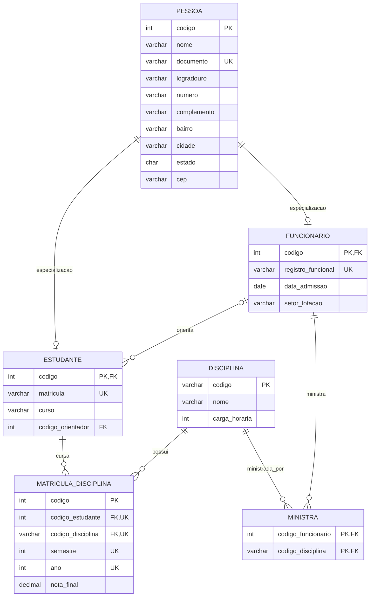

# 3. Universidade comunitária

Uma universidade cadastra pessoas com nome, documento e endereço, composto por logradouro, número, complemento, bairro, cidade, estado e CEP. Toda pessoa cadastrada é estudante, funcionária ou ambas as coisas. Estudantes possuem número de matrícula e curso; funcionários possuem registro funcional, data de admissão e setor de lotação. Um funcionário pode orientar vários estudantes, mas cada estudante tem no máximo um orientador, que deve ser funcionário. A universidade oferece disciplinas identificadas por código, nome e carga horária. Estudantes podem cursar várias disciplinas e cada disciplina pode ter vários estudantes; para cada matrícula em disciplina são guardados semestre, ano e nota final. Funcionários podem ministrar disciplinas, e uma disciplina pode ser ministrada por mais de um funcionário.

Modele **Pessoa** com especialização total e sobreposta (compartilhada) em **Estudante** e **Funcionário**. Considere que uma pessoa pode estar nas duas subentidades. Represente o autorrelacionamento de orientação com os papéis de orientador e orientado, o endereço composto e os relacionamentos acadêmicos.

## Diagrama Entidade Relacionamento



## DDL

### 1. PESSOA

```sql
CREATE TABLE pessoa (
    codigo NUMBER(10) PRIMARY KEY,
    nome VARCHAR2(100) NOT NULL,
    documento VARCHAR2(20) NOT NULL UNIQUE,
    logradouro VARCHAR2(100),
    numero VARCHAR2(10),
    complemento VARCHAR2(50),
    bairro VARCHAR2(50),
    cidade VARCHAR2(50),
    estado CHAR(2),
    cep VARCHAR2(8)
);
```

### 2. FUNCIONARIO

```sql
CREATE TABLE funcionario (
    codigo NUMBER(10) PRIMARY KEY,
    registro_funcional VARCHAR2(20) NOT NULL UNIQUE,
    data_admissao DATE NOT NULL,
    setor_lotacao VARCHAR2(100) NOT NULL,

    CONSTRAINT fk_funcionario_pessoa
        FOREIGN KEY (codigo)
        REFERENCES pessoa(codigo)
);
```

### 3. ESTUDANTE

```sql
CREATE TABLE estudante (
    codigo NUMBER(10) PRIMARY KEY,
    matricula VARCHAR2(20) NOT NULL UNIQUE,
    curso VARCHAR2(100) NOT NULL,
    codigo_orientador NUMBER(10),

    CONSTRAINT fk_estudante_pessoa
        FOREIGN KEY (codigo)
        REFERENCES pessoa(codigo),

    CONSTRAINT fk_estudante_orientador
        FOREIGN KEY (codigo_orientador)
        REFERENCES funcionario(codigo)
);
```
### 4. DISCIPLINA

```sql
CREATE TABLE disciplina (
    codigo NUMBER(10) PRIMARY KEY,
    nome VARCHAR2(100) NOT NULL,
    carga_horaria NUMBER(4) NOT NULL
);
```

### 5. MATRICULA_DISCIPLINA (N:M)

```sql
CREATE TABLE matricula_disciplina (
    codigo NUMBER(10) NOT NULL PRIMARY KEY,
    codigo_estudante NUMBER(10) NOT NULL,
    codigo_disciplina NUMBER(10) NOT NULL,
    semestre NUMBER(1) NOT NULL,
    ano NUMBER(4) NOT NULL,
    nota_final NUMBER(4,2),

    CONSTRAINT uk_matricula_disciplina
        UNIQUE (
            codigo_estudante,
            codigo_disciplina,
            semestre,
            ano
        ),

    CONSTRAINT fk_md_estudante
        FOREIGN KEY (codigo_pessoa_estudante)
        REFERENCES estudante(codigo_pessoa),

    CONSTRAINT fk_md_disciplina
        FOREIGN KEY (codigo_disciplina)
        REFERENCES disciplina(codigo_disciplina),

    CONSTRAINT ck_md_semestre
        CHECK (semestre IN (1, 2)),

    CONSTRAINT ck_md_nota
        CHECK (nota_final BETWEEN 0 AND 10)
);
```

### 6. MINISTRA (N:M)

```sql

CREATE TABLE ministra (
    codigo_pessoa_funcionario NUMBER(10) NOT NULL,
    codigo_disciplina NUMBER(10) NOT NULL,

    CONSTRAINT pk_ministra
        PRIMARY KEY (
            codigo_pessoa_funcionario,
            codigo_disciplina
        ),

    CONSTRAINT fk_ministra_funcionario
        FOREIGN KEY (codigo_pessoa_funcionario)
        REFERENCES funcionario(codigo_pessoa),

    CONSTRAINT fk_ministra_disciplina
        FOREIGN KEY (codigo_disciplina)
        REFERENCES disciplina(codigo_disciplina)
);
```

### 7. SEQUENCES

```sql
CREATE SEQUENCE seq_pessoa
START WITH 1
INCREMENT BY 1
NOCACHE
NOCYCLE;

CREATE SEQUENCE seq_disciplina
START WITH 1
INCREMENT BY 1
NOCACHE
NOCYCLE;
```

### 8. TRIGGERS DE AUTOINCREMENTO

```sql
CREATE OR REPLACE TRIGGER trg_pessoa_bi
BEFORE INSERT ON pessoa
FOR EACH ROW
BEGIN
    IF :NEW.codigo_pessoa IS NULL THEN
        SELECT seq_pessoa.NEXTVAL
        INTO :NEW.codigo_pessoa
        FROM dual;
    END IF;
END;
/

CREATE OR REPLACE TRIGGER trg_disciplina_bi
BEFORE INSERT ON disciplina
FOR EACH ROW
BEGIN
    IF :NEW.codigo_disciplina IS NULL THEN
        SELECT seq_disciplina.NEXTVAL
        INTO :NEW.codigo_disciplina
        FROM dual;
    END IF;
END;
/
```

## DTL

### Commit
```sql
COMMIT;
```

### Rollback

## DML

-- ── 1. INSERT em PESSOA ───────────────────────────────────────
-- Cadastrar pessoas com documento único e endereço composto.


-- ── 2. INSERT em FUNCIONARIO ─────────────────────────────────
-- Vincular funcionários a códigos de pessoas já existentes.


-- ── 3. INSERT em ESTUDANTE ───────────────────────────────────
-- Cadastrar estudantes apontando para código de pessoa.
-- Incluir estudantes com orientador (id_orientador) e sem orientador (NULL).


-- ── 4. Especialização Sobreposta (Estudante E Funcionário) ────
-- Demonstrar a inserção de uma mesma pessoa em FUNCIONARIO e ESTUDANTE.


-- ── 5. INSERT em DISCIPLINA ───────────────────────────────────
-- Cadastrar disciplinas com código alfanumérico (ex: 'CC001') e carga horária.


-- ── 6. INSERT em MINISTRA ────────────────────────────────────
-- Associar docentes a disciplinas.
-- Demonstrar uma disciplina ministrada por mais de um docente.


-- ── 7. INSERT em MATRICULA_DISCIPLINA ─────────────────────────
-- Matricular estudantes em disciplinas (com semestre, ano e nota final).


-- ── 8. UPDATE ─────────────────────────────────────────────────
-- Exercícios:
-- a) Lançar ou alterar a nota de um estudante.
-- b) Atribuir ou trocar o orientador de um estudante.
-- c) Atualizar endereço de uma pessoa.


-- ── 9. DELETE ─────────────────────────────────────────────────
-- Exercícios:
-- a) Remover uma matrícula específica em disciplina.
-- b) Testar remoção com integridade referencial (ON DELETE CASCADE).


## DQL

### 1. Listar todas as pessoas com endereço completo formatado 


### 2. Listar todos os estudantes com dados pessoais (JOIN com PESSOA) 


-- ── 3. Listar todos os funcionários com setor e data de admissão 


-- ── 4. Pessoas que são Estudante E Funcionário (Especialização Sobreposta) 


-- ── 5. Disciplinas com carga horária >= 60 horas ───────────────


-- ── 6. Estudantes matriculados em uma disciplina específica (ex: 'CC001') 


-- ── 7. Histórico escolar: notas de cada estudante por disciplina e ano (com CASE WHEN) 


-- ── 8. Funcionários e as disciplinas que ministram (N:M) ───────


-- ── 9. Orientadores e seus orientados (Autorrelacionamento via FUNCIONARIO) 


-- ── 10. Estudantes que ainda NÃO possuem orientador (IS NULL) ──


-- ── 11. Média de notas por disciplina (COUNT, AVG, MIN, MAX e GROUP BY) 


-- ── 12. Estudantes aprovados (nota >= 6.0) em cada disciplina ──


-- ── 13. Quantidade de orientandos por funcionário (GROUP BY) ───


-- ── 14. Todos os estudantes e seus orientadores (LEFT JOIN e COALESCE) 


-- ── 15. Total de disciplinas e carga horária ministrada por docente 


