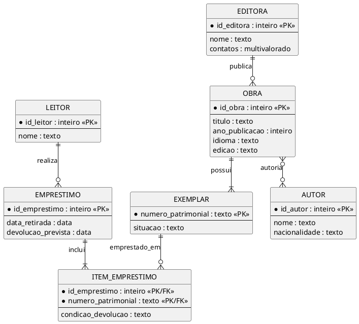
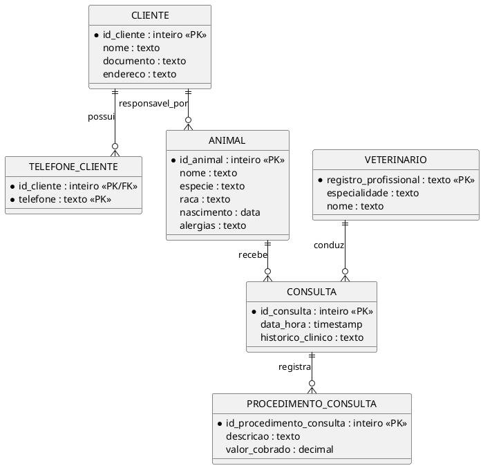
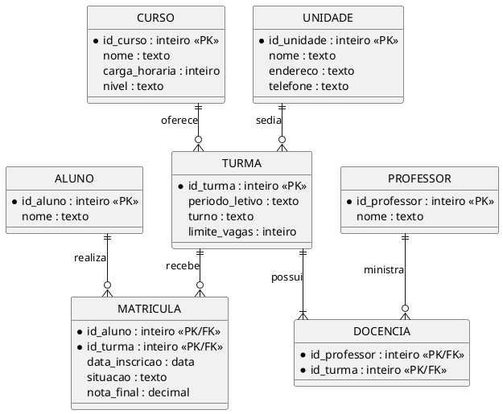
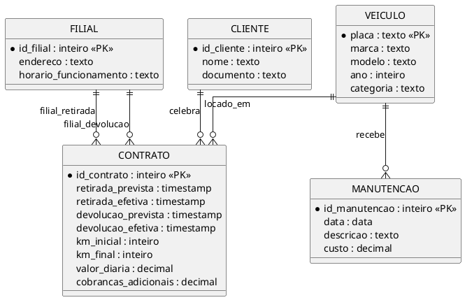
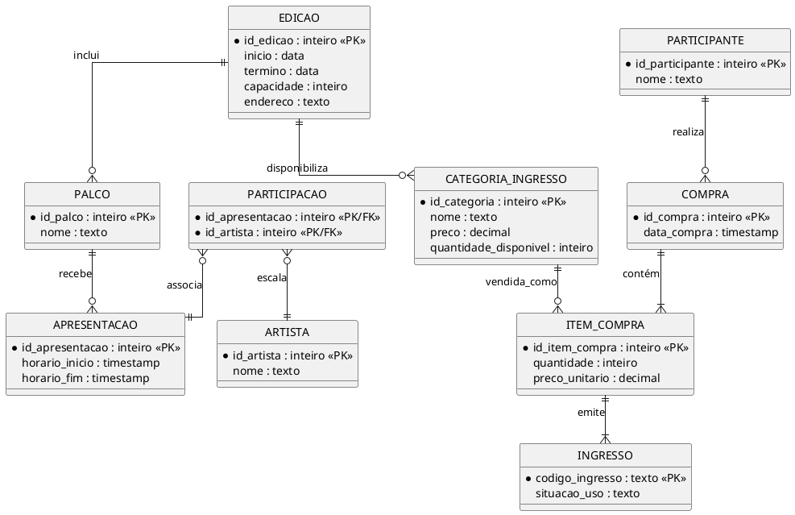
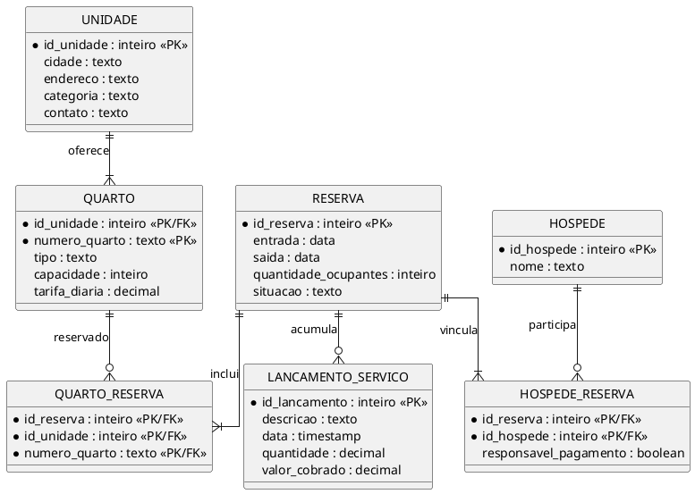
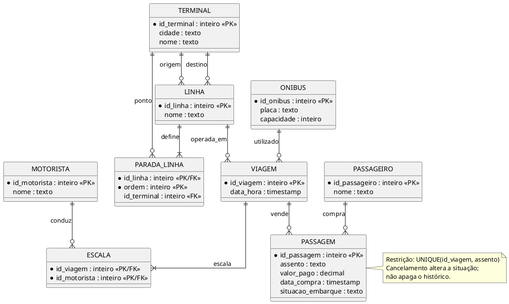

# Lista de exercícios 01 - Gabarito em PlantUML

Cada enunciado vem antes de uma proposta de modelo conceitual. As premissas registram decisoes necessarias quando o texto nao determina regras especificas. Os diagramas usam notacao de pe-de-galinha e podem ser reproduzidos no brModelo.

---

## 01. Biblioteca municipal

Uma biblioteca municipal mantém o acervo de obras e os dados de seus exemplares. De cada obra são registrados título, ano de publicação, idioma e edição; cada exemplar recebe um número patrimonial e pode estar emprestado ou disponível. A biblioteca trabalha com editoras e autores, mantém o nome e os contatos das editoras e o nome e a nacionalidade dos autores. Uma obra pode ter mais de um autor, e um autor pode participar de várias obras. Leitores cadastrados podem realizar empréstimos, registrando as datas de retirada e devolução prevista; cada empréstimo pode incluir mais de um exemplar, e o sistema deve registrar a condição de devolução de cada exemplar.

### Premissas adotadas

Obra é distinta de exemplar; o empréstimo pode incluir vários exemplares e a condição de devolução é por exemplar emprestado. Uma obra pode ter no máximo uma editora no cadastro proposto; ajuste se houver coedição.

### Modelo PlantUML



---

## 02. Clínica veterinária

Uma clínica veterinária atende clientes e animais, registra consultas e mantém o histórico clínico. Para cada cliente são armazenados nome, documento, endereço e telefones de contato; para cada animal são registrados nome, espécie, raça, data de nascimento e observações sobre alergias. Cada consulta ocorre em uma data e horário, é conduzida por um veterinário e pode gerar um ou mais procedimentos, com descrição e valor cobrados naquela consulta. Os veterinários possuem registro profissional e especialidade, e podem atender diferentes animais ao longo do tempo.

### Premissas adotadas

Telefone de cliente é multivalorado. Cada consulta pertence a um animal e é conduzida por um veterinário. Procedimento e valor são registrados por ocorrência de procedimento na consulta.

### Modelo PlantUML



---

## 03. Cursos e matrículas

Uma instituição oferece cursos em diferentes unidades. Cada curso possui nome, carga horária e nível, enquanto cada unidade possui nome, endereço e telefone. As turmas pertencem a um curso e a uma unidade, têm período letivo, turno e limite de vagas, e são conduzidas por professores. Um professor pode ministrar várias turmas e uma turma pode ter mais de um professor. Alunos podem se matricular em diferentes turmas; para cada matrícula são guardadas a data de inscrição, a situação e a nota final.

### Premissas adotadas

Turma pertence a um curso e a uma unidade; professor-turma e aluno-turma são N:N, esta última com matrícula própria.

### Modelo PlantUML



---

## 04. Locadora de veículos

Uma locadora administra filiais, clientes, veículos e contratos de locação. Cada filial possui endereço e horário de funcionamento, e os veículos cadastrados têm placa, marca, modelo, ano e categoria. Um cliente pode retirar um veículo em uma filial e devolvê-lo em outra. Cada contrato registra as datas e horários previstos e efetivos da retirada e da devolução, a quilometragem inicial e final, o valor da diária acordado e eventuais cobranças adicionais. A empresa também registra as manutenções realizadas em cada veículo, incluindo data, descrição do serviço e custo.

### Premissas adotadas

Retirada e devolução são dois papéis distintos de FILIAL. Contratos preservam histórico; manutenção pertence ao veículo.

### Modelo PlantUML



---

## 05. Festival de música

Um festival organiza edições anuais realizadas em diferentes locais. Cada edição tem datas de início e término, capacidade de público e endereço do local. A programação reúne apresentações de artistas em palcos e horários definidos; um artista pode participar de várias apresentações e uma apresentação pode reunir mais de um artista. O festival vende ingressos em categorias, com preço e quantidade disponíveis, e registra as compras feitas pelos participantes, incluindo data da compra e quantidade de ingressos de cada categoria. Cada ingresso emitido possui um código próprio e uma situação de uso.

### Premissas adotadas

Categoria de ingresso e preço são definidos por edição; ingresso emitido individualmente identifica uso e compra. Palco e apresentação pertencem à edição.

### Modelo PlantUML



---

## 06. Pedidos de restaurante

Um restaurante recebe pedidos para consumo no salão, retirada no balcão ou entrega. O cardápio contém produtos com nome, descrição e preço atual, organizados em categorias. Cada pedido registra data e horário, canal de atendimento, situação e forma de pagamento, e está associado a um cliente quando há identificação. Um pedido pode conter vários produtos, e para cada produto solicitado são informadas a quantidade, observações de preparo e o preço aplicado no momento do pedido. Nas entregas, o restaurante registra endereço, horário de saída, entregador responsável e horário de conclusão.

### Premissas adotadas

Cliente em pedido é opcional; cada produto pertence a uma categoria. Dados de entrega só existem para pedido com canal de entrega.

### Modelo PlantUML

```plantuml
@startuml
hide circle
skinparam linetype ortho
entity CATEGORIA {
  * id_categoria : inteiro <<PK>>
  nome : texto
}
entity PRODUTO {
  * id_produto : inteiro <<PK>>
  nome : texto
  descricao : texto
  preco_atual : decimal
}
entity CLIENTE {
  * id_cliente : inteiro <<PK>>
  nome : texto
}
entity PEDIDO {
  * id_pedido : inteiro <<PK>>
  data_hora : timestamp
  canal : texto
  situacao : texto
  forma_pagamento : texto
}
entity ITEM_PEDIDO {
  * id_pedido : inteiro <<PK/FK>>
  * id_produto : inteiro <<PK/FK>>
  quantidade : inteiro
  observacao_preparo : texto
  preco_aplicado : decimal
}
entity ENTREGA {
  * id_pedido : inteiro <<PK/FK>>
  endereco : texto
  horario_saida : timestamp
  horario_conclusao : timestamp
}
entity ENTREGADOR {
  * id_entregador : inteiro <<PK>>
  nome : texto
}
CATEGORIA ||--o{ PRODUTO : classifica
CLIENTE o|--o{ PEDIDO : identifica
PEDIDO ||--|{ ITEM_PEDIDO : contém
PRODUTO ||--o{ ITEM_PEDIDO : solicitado
PEDIDO ||--o| ENTREGA : pode_gerar
ENTREGADOR ||--o{ ENTREGA : realiza
@enduml
```

---

## 07. Oficina de manutenção industrial

Uma empresa de manutenção atende fábricas que possuem máquinas instaladas em setores. Cada máquina tem número de patrimônio, fabricante, modelo e data de instalação; cada setor tem nome e localização dentro da fábrica. A empresa abre ordens de serviço para registrar a máquina atendida, as datas de abertura e conclusão, a prioridade e a situação do atendimento. Técnicos participam das ordens de serviço, com o tempo trabalhado por técnico em cada ordem. Uma ordem pode exigir peças do estoque, e o sistema registra a quantidade e o custo de cada peça utilizada. Alguns técnicos supervisionam outros técnicos.

### Premissas adotadas

Fábrica, setor e máquina formam hierarquia; peças e técnicos associam-se às ordens por ocorrências com quantidade/custo ou horas.

### Modelo PlantUML

```plantuml
@startuml
hide circle
skinparam linetype ortho
entity FABRICA {
  * id_fabrica : inteiro <<PK>>
  nome : texto
}
entity SETOR {
  * id_setor : inteiro <<PK>>
  nome : texto
  localizacao : texto
}
entity MAQUINA {
  * patrimonio : texto <<PK>>
  fabricante : texto
  modelo : texto
  data_instalacao : data
}
entity ORDEM_SERVICO {
  * id_ordem : inteiro <<PK>>
  abertura : timestamp
  conclusao : timestamp
  prioridade : texto
  situacao : texto
}
entity TECNICO {
  * id_tecnico : inteiro <<PK>>
  nome : texto
}
entity TRABALHO_TECNICO {
  * id_ordem : inteiro <<PK/FK>>
  * id_tecnico : inteiro <<PK/FK>>
  horas_trabalhadas : decimal
}
entity PECA {
  * id_peca : inteiro <<PK>>
  descricao : texto
}
entity USO_PECA {
  * id_ordem : inteiro <<PK/FK>>
  * id_peca : inteiro <<PK/FK>>
  quantidade : inteiro
  custo_unitario : decimal
}
FABRICA ||--|{ SETOR : contém
SETOR ||--o{ MAQUINA : instala
MAQUINA ||--o{ ORDEM_SERVICO : atendida_em
ORDEM_SERVICO ||--|{ TRABALHO_TECNICO : recebe
TECNICO ||--o{ TRABALHO_TECNICO : executa
ORDEM_SERVICO ||--o{ USO_PECA : consome
PECA ||--o{ USO_PECA : utilizada
TECNICO o|--o{ TECNICO : supervisiona
@enduml
```

---

## 08. Hotelaria

Uma rede hoteleira administra unidades em diferentes cidades. Cada unidade possui endereço, categoria e dados de contato, e oferece quartos identificados por número, tipo, capacidade e tarifa diária. Hóspedes fazem reservas informando período de entrada e saída, quantidade de ocupantes e situação da reserva; uma reserva pode incluir mais de um quarto. O hotel registra os hóspedes vinculados a cada reserva e identifica quem será o responsável pelo pagamento. Durante a hospedagem, podem ser lançados serviços como lavanderia e restaurante, com data, quantidade e valor cobrado.

### Premissas adotadas

Número do quarto é único dentro da unidade, não necessariamente na rede. Ocupantes e quartos são associados à reserva; serviços são lançamentos da hospedagem.

### Modelo PlantUML



---

## 09. Transporte rodoviário

Uma empresa de transporte opera linhas entre cidades e mantém os dados de terminais, ônibus, motoristas e viagens. Cada linha possui origem, destino e paradas intermediárias ordenadas. Uma viagem corresponde à operação de uma linha em uma data e horário específicos, utiliza um ônibus e tem um ou mais motoristas escalados. Passageiros compram passagens para viagens, escolhem assentos e podem cancelar a compra conforme as regras da empresa. Para cada passagem são registrados o valor pago, a data da compra e a situação do embarque.

### Premissas adotadas

A linha tem terminais de origem e destino e paradas ordenadas. Assento é único por viagem. Uma passagem pertence a um passageiro e viagem.

### Modelo PlantUML



---

## 10. Projetos de software

Uma empresa de tecnologia mantém departamentos e projetos contratados por clientes. Cada departamento tem nome e localização; cada projeto possui título, datas planejadas, orçamento e situação. Funcionários pertencem a departamentos e podem atuar em vários projetos, exercendo funções diferentes e registrando as horas trabalhadas em cada projeto por semana. Clientes possuem razão social e contatos, e podem contratar diversos projetos. Em cada projeto são registradas entregas com descrição, data prevista, data efetiva e responsável. Funcionários também podem supervisionar outros funcionários.

### Premissas adotadas

Responsável por entrega é funcionário; a regra de que ele deve estar alocado ao projeto não está escrita, então deve ser validada como restrição adicional.

### Modelo PlantUML

```plantuml
@startuml
hide circle
skinparam linetype ortho
entity DEPARTAMENTO {
  * id_departamento : inteiro <<PK>>
  nome : texto
  localizacao : texto
}
entity FUNCIONARIO {
  * id_funcionario : inteiro <<PK>>
  nome : texto
}
entity CLIENTE {
  * id_cliente : inteiro <<PK>>
  razao_social : texto
  contatos : multivalorado
}
entity PROJETO {
  * id_projeto : inteiro <<PK>>
  titulo : texto
  inicio_planejado : data
  fim_planejado : data
  orcamento : decimal
  situacao : texto
}
entity ALOCACAO {
  * id_funcionario : inteiro <<PK/FK>>
  * id_projeto : inteiro <<PK/FK>>
  * semana : data
  funcao : texto
  horas : decimal
}
entity ENTREGA {
  * id_entrega : inteiro <<PK>>
  descricao : texto
  data_prevista : data
  data_efetiva : data
}
DEPARTAMENTO ||--o{ FUNCIONARIO : lota
CLIENTE ||--o{ PROJETO : contrata
FUNCIONARIO ||--o{ ALOCACAO : atua
PROJETO ||--o{ ALOCACAO : recebe
PROJETO ||--o{ ENTREGA : produz
FUNCIONARIO ||--o{ ENTREGA : responsavel
FUNCIONARIO o|--o{ FUNCIONARIO : supervisiona
@enduml
```