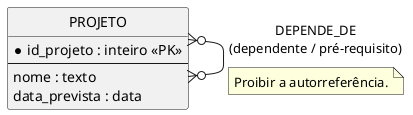

# Aula 03 — Gabarito

## Exercício da primeira metade — supervisão recursiva

Entidade `FUNCIONARIO`; auto-relacionamento `SUPERVISIONA`, com papéis `supervisor` e `supervisionado`. Um funcionário pode supervisionar zero ou muitos (`supervisor 0..N`). No conjunto geral, um funcionário pode ter zero ou um supervisor (`supervisionado 0..1`); a regra adicional determina que todos, exceto o diretor-geral, tenham exatamente um. A ocorrência de diretor-geral é a exceção ao mínimo obrigatório. Não se deve admitir que alguém supervisione a si próprio.

## Classificação de especializações

- **Caso A — Conta bancária:** total e disjunta `(t,d)`. Toda conta é corrente ou poupança e não pode pertencer simultaneamente aos dois subtipos.
- **Caso B — Colaborador:** parcial e sobreposta `(p,o)`. Pode não pertencer a subtipo algum e pode ser instrutor e brigadista ao mesmo tempo.

## Exercício 1 — projetos e pré-requisitos

`PROJETO(id_projeto, nome, data_prevista)` participa de um auto-relacionamento N:N `DEPENDE_DE`. Papéis: `projeto_dependente` e `pré_requisito`. Em ambos os papéis, cardinalidade `(0,N)`: o projeto pode não ter pré-requisito e pode depender de vários; pode não ser pré-requisito de nenhum ou ser pré-requisito de vários. Restrição: um projeto não pode depender de si mesmo.



## Fixação — atributos da venda

`PEDIDO` e `PRODUTO` têm relacionamento N:N. `quantidade` e `preco_efetivo` variam por ocorrência de produto em pedido: ficam no relacionamento `CONTEM`, não na entidade PRODUTO nem na entidade PEDIDO. Nome do produto pertence a PRODUTO; data de emissão pertence a PEDIDO.

## Matrícula: entidade associativa e migração N:N

`ALUNO` e `DISCIPLINA` relacionam-se N:N. Quando a matrícula registra período, data, nota e frequência, pode ser representada como entidade associativa `MATRICULA` ligada a ALUNO e DISCIPLINA por dois relacionamentos 1:N. Cada matrícula pertence a exatamente um aluno e a uma disciplina; cada aluno e disciplina podem ter zero ou várias matrículas.

```text
ALUNO(id_aluno PK, nome)
DISCIPLINA(id_disciplina PK, nome)
MATRICULA(id_aluno PK/FK, id_disciplina PK/FK, semestre PK,
          data_matricula, nota_final, frequencia)
```

A PK composta `(id_aluno, id_disciplina, semestre)` traduz a regra de uma matrícula por aluno, disciplina e semestre. Se o domínio permitir mais de uma no mesmo período, inclua um discriminador adicional ou use identificador próprio.

## Exercício intermediário — contratos

Entidade associativa `CONTRATO`, com `data_inicio`, `data_encerramento` e `valor_mensal`, transforma `CONSULTOR N:N CLIENTE` em `CONSULTOR 1:N CONTRATO` e `CLIENTE 1:N CONTRATO`. Como o histórico precisa admitir múltiplos contratos do mesmo par, uma PK simples `id_contrato` é uma alternativa direta; outra é `(id_consultor, id_cliente, data_inicio)` se essa combinação for garantidamente única.

Sem identidade própria para o contrato, não se distinguem adequadamente períodos e valores de contratos sucessivos entre o mesmo consultor e cliente; atualizar um vínculo poderia sobrescrever o histórico.

## Exercício 2 — alocação de equipe em projetos

No DER, representar `PARTICIPACAO` como associação/entidade associativa entre `COLABORADOR` e `PROJETO`. Cada participação está ligada a exatamente um colaborador e um projeto; cada colaborador e projeto podem ter zero ou várias participações. `papel`, `horas_semanais` e `data_inicio` pertencem ao vínculo.

```text
COLABORADOR(id_colaborador PK, nome)
PROJETO(id_projeto PK, nome)
PARTICIPACAO(id_participacao PK, id_colaborador FK,
             id_projeto FK, papel, horas_semanais, data_inicio)
```

Os identificadores de colaborador e projeto são FKs em PARTICIPACAO. Um identificador próprio permite registrar reingressos do mesmo colaborador no projeto. Se a regra proibisse mais de uma participação por par, uma PK composta poderia ser usada; se houver períodos sucessivos, a chave precisará distinguir cada ocorrência.
