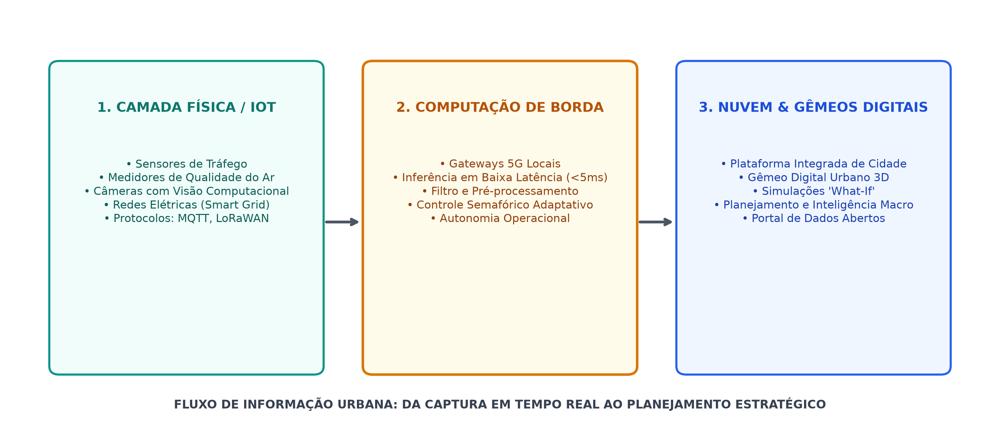
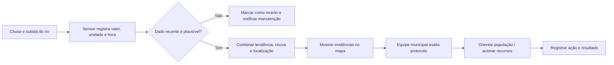
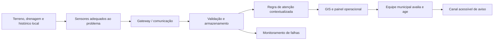

# Aula 04 — Cidades Inteligentes e Sistemas Ciber-Físicos

**Disciplina:** Sistemas de Informação e Tecnologias Emergentes (ISI022)  
**Duração:** 1h40min  
**Módulo:** 4 — Smart Cities e IoT

## Objetivos de aprendizagem

Ao final da aula, a turma deverá ser capaz de:

- explicar como dados e serviços digitais conectam infraestrutura urbana a decisões operacionais;
- identificar sensores, atuadores, conectividade, plataforma de dados e atores em um Sistema Ciber-Físico (CPS);
- desenhar o fluxo de dados de um sistema municipal de monitoramento de chuva e nível de rios;
- apontar limites de automação, qualidade dos dados e responsabilidades na emissão de alertas.

## Escopo das seções deste documento

| Seção | O que apresenta |
|---|---|
| Objetivos e roteiro | O que será aprendido e como os 100 minutos serão organizados. |
| 1. Da cidade conectada à cidade inteligente | A ideia de Smart City com exemplos simples de serviços urbanos. |
| 2. Sistema Ciber-Físico (CPS) | As camadas de campo, transporte e plataforma, com imagem e exemplos. |
| 3. Caso demonstrativo | Como uma leitura de chuva e nível pode apoiar um alerta, incluindo dados, falhas, segurança e limites. |
| 4. Exercício prático | Investigação do bairro escolhido pela dupla e desenho de uma proposta adequada ao contexto encontrado. |
| Perguntas para discussão e glossário | Questões para revisar decisões e explicação dos termos técnicos usados. |
| Síntese e referências | Recapitulação, conexão com a Aula 05 e fontes para aprofundamento. |

O produto final do exercício será um **PDF enviado no espaço da turma no Teams**. A pesquisa deve usar fontes identificáveis e separar fatos encontrados, relatos de moradores e hipóteses da dupla.

## Roteiro da aula

| Tempo | Etapa |
|---|---|
| 0–10 min | Pergunta disparadora: como a cidade saberia que um bairro corre risco de alagamento? |
| 10–25 min | Cidade tradicional, cidade inteligente e decisões orientadas por dados |
| 25–45 min | CPS: sensores e atuadores, comunicação e plataforma analítica/GIS |
| 45–60 min | Demonstração do fluxo de um alerta, incluindo validação e intervenção humana |
| 60–100 min | Exercício em duplas: investigar o bairro, contextualizar os riscos e desenhar a proposta CPS |

## 1. Da cidade conectada à cidade inteligente

Uma cidade inteligente usa tecnologia e dados para melhorar serviços urbanos e apoiar decisões. Instalar sensores, por si só, não torna um serviço inteligente: é necessário transformar medições confiáveis em informação útil, encaminhá-la a quem pode agir e avaliar o resultado.

Pense em uma lâmpada de rua. Uma lâmpada comum acende em horário programado. Uma lâmpada conectada pode também informar que queimou, reduzir a intensidade quando a rua está vazia e permitir que a equipe priorize o conserto. O ganho vem do serviço melhorado — menos pontos escuros e manutenção mais rápida — e não do sensor isolado.

O ciclo básico é **observar → comunicar → interpretar → decidir/agir → avaliar**. Sistemas de informação integram dados de campo, equipes e processos municipais; a cidade continua sendo um sistema sociotécnico, no qual pessoas, regras, infraestrutura e tecnologia atuam em conjunto.

## 2. Sistema Ciber-Físico (CPS)

Um CPS integra processos físicos com computação e comunicação. Para análise inicial, use três camadas:

1. **Campo — sensoriamento e atuação:** pluviômetros, sensores de nível, estações meteorológicas, sirenes, painéis e dispositivos de controle. Cada medição precisa de unidade, horário, identificação do local e estado do dispositivo.
2. **Transporte — telemetria e conectividade:** redes celulares, rádio, LoRaWAN ou enlaces municipais levam leituras e comandos. Considere cobertura, energia, atraso, perda de pacotes e proteção das comunicações. A escolha de protocolo será aprofundada na Aula 05.
3. **Plataforma — processamento, integração e visualização:** ingestão, validação, armazenamento temporal, regras de alerta, integração com GIS/mapas e painéis para equipes. A plataforma pode distribuir alertas para canais operacionais e para a população.

O fluxo não é apenas de entrada: decisões podem voltar ao campo como comandos para sirenes ou painéis. A ação deve ser autorizada, registrada e monitorada.



*Figura 1 — Uma arquitetura possível. O diagrama mostra computação de borda entre os dispositivos e a plataforma. Nem toda cidade precisa de uma camada de borda separada; a escolha depende da latência, conectividade e necessidade de agir localmente.*

### Exemplos urbanos nas mesmas camadas

| Serviço | Campo: o que observa/atua | Plataforma: que informação organiza | Exemplo de resposta |
|---|---|---|---|
| Trânsito | Laço indutivo ou câmera estima fluxo de veículos; semáforo atua | Fluxo por aproximação e fila estimada | Ajustar o tempo do sinal conforme plano aprovado |
| Iluminação | Fotocélula mede claridade; controlador informa falha | Mapa de luminárias, consumo e chamados | Abrir ordem de manutenção ou ajustar horário |
| Resíduos | Sensor estima ocupação de uma lixeira | Mapa de pontos cheios e rotas de coleta | Reordenar uma rota, respeitando capacidade dos caminhões |
| Água | Medidor acompanha vazão e pressão | Consumo por zona e anomalias ao longo do tempo | Investigar possível vazamento antes de enviar equipe |
| Enchentes | Pluviômetro e sensor de nível | Chuva, nível, tendência e área geográfica | Informar a Defesa Civil e acionar o protocolo local |

Esses exemplos seguem o mesmo raciocínio, mas não usam necessariamente os mesmos sensores, redes ou regras. Uma câmera de trânsito, por exemplo, pode levantar questões de privacidade que não aparecem da mesma forma em um pluviômetro.

## 3. Caso demonstrativo: alerta de inundação

Considere sensores de chuva e nível instalados em pontos críticos de uma bacia urbana.

1. O sensor envia uma leitura com identificador, valor, unidade e horário.
2. O gateway encaminha a telemetria, preservando a origem e indicando falhas de comunicação quando possível.
3. A plataforma valida faixa plausível, atualidade e consistência com sensores próximos. Uma leitura ausente ou suspeita não deve ser tratada como confirmação de segurança.
4. Regras combinam nível atual, tendência, chuva e contexto local; o GIS relaciona o ponto à área potencialmente afetada.
5. O sistema apresenta o alerta e as evidências à defesa civil ou à equipe responsável, que aplica o protocolo municipal. A automação pode acionar sirenes quando critérios e procedimentos locais permitirem.
6. Eventos, decisões e confirmações são registrados. Após o evento, a equipe compara os alertas com o que ocorreu e ajusta o sistema.

**Princípio operacional:** uma decisão crítica precisa tratar falhas, leituras antigas e perda de conectividade como estados explícitos. Não confunda “sem dado” com “sem risco”.

### Exemplo de uma leitura

Uma estação pode enviar um registro parecido com este:

```json
{
  "sensor_id": "rio-centro-02",
  "timestamp": "2026-10-22T14:05:00-03:00",
  "rain_mm_10min": 18.4,
  "water_level_cm": 142,
  "battery_pct": 76,
  "status": "ok"
}
```

O número `142` sozinho não diz se há perigo. O sistema precisa saber que é nível em centímetros, onde e quando foi medido, como esse ponto costuma se comportar e qual regra municipal está em vigor. Para a atividade, os valores e limites serão hipotéticos; alarmes reais devem usar dados locais validados por especialistas e protocolos oficiais.



*Figura 2 — Fluxo didático de um alerta. O losango explicita que qualidade dos dados deve ser verificada antes da interpretação.*

### Um exemplo de regra, sem transformar isso em receita

Para uma simulação em sala, a dupla pode inventar um limite didático, por exemplo: “se duas leituras seguidas de nível estiverem acima do limite fictício e o sensor estiver atualizado, o painel mostra atenção”. Em seguida, discuta o que falta: a velocidade da subida, a chuva a montante, a localização das casas, o histórico de erro do sensor e a confirmação da equipe. A regra simples serve para ensinar lógica; não deve ser usada para alertas reais.

### Segurança, privacidade e inclusão no exemplo

- Um atacante que falsifique leituras pode provocar alarme indevido ou esconder um risco. Proteja dispositivos, contas e canais de comunicação e registre mudanças.
- Use acesso por função: manutenção pode diagnosticar sensores; apenas operadores autorizados alteram regras ou confirmam alertas.
- Mostre a informação no painel com horário e estado do sensor. Quando a conexão cai, apresente “sem atualização desde…” em vez de deixar um valor antigo parecer atual.
- Planeje mensagens acessíveis por mais de um canal — por exemplo, SMS, rádio, sirene e avisos em locais públicos — considerando pessoas sem internet ou com deficiência.
- Colete só os dados necessários. Uma rede de sensores ambientais não precisa identificar moradores.

## 4. Exercício prático — conheça o território antes de projetar (40 minutos)

O enunciado completo, pronto para publicação como tarefa, está em [Enunciado_Atividade_Bairro_CPS.md](Enunciado_Atividade_Bairro_CPS.md).

### Desafio

Escolham um bairro onde **um dos integrantes da dupla mora**. Antes de propor sensores ou sistemas, caracterizem o lugar: terreno, água, ocupação, riscos e memória de enchentes. Só depois definam o problema prioritário e desenhem uma solução de monitoramento e resposta.

Não incluam endereço residencial, nomes de moradores ou outras informações pessoais no trabalho. Se a dupla não conhecer um histórico de enchente no bairro, registrem isso como “não confirmado nas fontes consultadas”; não inventem ocorrências.

### Etapas

1. **Escolham e localizem o bairro (3 min):** indiquem município/UF e bairro. Usem um mapa público para delimitar aproximadamente a área; não marquem a casa do integrante.
2. **Caracterizem o terreno e a água (7 min):** observem relevo (baixada, encosta, vale), proximidade de rios/córregos, drenagem, áreas impermeáveis, declives e ocupação. Registrem o que foi visto em mapa e o que é observação/relato.
3. **Investiguem riscos e histórico (8 min):** procurem registros de alagamento, inundação, enxurrada ou deslizamento. Anotem datas/períodos quando disponíveis, locais, impactos e a fonte. Diferenciem “suscetibilidade mapeada” de “evento que de fato ocorreu”.
4. **Definam o problema prioritário (4 min):** resumam quem ou o que está exposto e qual decisão precisa melhorar (por exemplo, avisar moradores de uma rua baixa ou apoiar o fechamento de uma passagem).
5. **Desenhem uma arquitetura coerente (10 min):** escolham sensores e, se fizer sentido, atuadores/canais de aviso; conectem campo → comunicação → plataforma/GIS → equipe/população. Nomeiem os dados e expliquem por que a solução combina com o terreno e o risco estudado.
6. **Tratem falhas e organizem a entrega (8 min):** incluam uma falha de sensor, uma interrupção de comunicação e uma leitura suspeita; indiquem como serão percebidas e quem decide a resposta. Confiram fontes, clareza e ausência de dados pessoais. Usem o tempo após a aula para finalizar a diagramação, se necessário, e enviem o PDF no Teams.

### Onde pesquisar

Comecem por fontes públicas e locais. A disponibilidade varia de município para município:

- **Prefeitura e Defesa Civil municipal:** mapas locais, planos de contingência, notícias, alertas e registros de ocorrências.
- **Atlas Digital de Desastres no Brasil (MIDR):** filtre por estado, município e tipo de evento; os registros são apresentados em escala municipal, portanto não provam que um evento atingiu uma rua específica. [Atlas e mapa interativo](https://atlasdigital.mdr.gov.br/).
- **Serviço Geológico do Brasil (SGB):** cartas de suscetibilidade a inundações e movimentos de massa; indicam possibilidade física, não a confirmação de uma enchente histórica. [Cartografia de suscetibilidade](https://www.sgb.gov.br/pt/web/guest/cartografia-de-suscetibilidade).
- **ANA / HidroWeb:** séries de chuva, nível e vazão de estações hidrometeorológicas; a estação pode ficar longe do bairro, então registrem sua localização e limitação. [Portal HidroWeb](https://www.snirh.gov.br/hidroweb/).
- **Cemaden Educação:** roteiro de consulta a mapas de risco municipais e perguntas para comparar mapas com conhecimento local. [Atividade de mapa de risco](https://educacao.cemaden.gov.br/atividade/acesse-um-mapa-de-risco-da-bacia-hidrografica-de-seu-municipio/).

Reportagens e relatos de moradores podem complementar a pesquisa, mas identifiquem autoria, data e local. Não usem uma notícia isolada como prova de que todo o bairro tem o mesmo risco.

### Entregável

Produzam **um PDF por dupla** e enviem-no no canal ou tarefa da disciplina no **Microsoft Teams**, conforme indicado pelo docente. O PDF deve conter as seções abaixo:

1. **Capa:** título, nomes dos integrantes, turma e data. Não incluir endereço residencial.
2. **Bairro e recorte:** município/UF, bairro e mapa ou croqui com a área estudada, sem marcar residências particulares.
3. **Contexto territorial:** descrição do relevo/terreno, cursos d’água, drenagem, ocupação e outras características relevantes, com legenda e fonte do mapa.
4. **Riscos e histórico:** eventos encontrados e/ou riscos indicados nos mapas; distinguir claramente ocorrência registrada, suscetibilidade mapeada, relato local e informação não confirmada.
5. **Problema e pessoas afetadas:** qual situação a dupla quer ajudar a monitorar e quem precisa da informação.
6. **Proposta CPS:** diagrama com sensores/atuadores, comunicação, plataforma/GIS, operadores e destino dos avisos. Justificar cada componente com o contexto do bairro.
7. **Dados, regra e resposta:** exemplo do que será medido, condição didática que gera atenção e o que a equipe faria. Valores-limite são hipotéticos e não devem ser apresentados como orientação oficial.
8. **Falhas, limites e cuidados:** sensor sem sinal, leitura errada, privacidade, acessibilidade dos avisos e responsabilidade pela decisão.
9. **Fontes consultadas:** links, instituição/autoria e data de acesso. Para mapas e imagens, informar também a origem.

O diagrama pode ser feito à mão (fotografado com boa legibilidade), em ferramenta de desenho ou em Mermaid. Modelo inicial:



## 5. Perguntas para discussão

1. O que uma medição isolada não permite concluir sobre o risco de inundação?
2. Como o painel deve apresentar uma leitura antiga ou um sensor sem comunicação?
3. Quais decisões podem ser automatizadas e quais exigem validação de uma equipe?
4. Que informação geográfica é necessária para que o alerta ajude as pessoas certas?
5. Se o sensor não atualiza há 20 minutos, que texto deveria aparecer no painel?
6. Uma câmera é sempre a melhor forma de contar veículos? Que alternativa preservaria mais privacidade?
7. Se a plataforma recomenda mudar o semáforo, quem pode aprovar a mudança e como desfazê-la em caso de falha?

## Glossário rápido

- **CPS (Sistema Ciber-Físico):** sistema em que software, comunicação e equipamentos físicos interagem.
- **IoT (Internet das Coisas):** dispositivos conectados que coletam ou trocam dados.
- **Telemetria:** envio de medições de um local remoto para acompanhamento.
- **Gateway:** equipamento intermediário que recebe dados de dispositivos e os encaminha a outro sistema.
- **GIS/SIG:** sistema de informação geográfica; organiza dados associados a locais e mapas.
- **Atuador:** componente que executa uma ação física, como ligar uma sirene ou ajustar uma luminária.
- **Interoperabilidade:** capacidade de sistemas diferentes trocarem e entenderem dados.

## Síntese

Uma Smart City depende da integração entre infraestrutura física, comunicação, dados, processos e pessoas. O CPS torna visível esse ciclo, mas a qualidade da decisão depende de dados contextualizados, tratamento de falhas e responsabilidades claras. Na próxima aula, a turma aprofundará os protocolos e padrões de telemetria IoT, incluindo MQTT e LoRaWAN.

## Referências bibliográficas e para aprofundamento

- NIST. *Cyber-Physical Systems and Internet of Things*. NIST SP 1900-202, 2018. [PDF](https://nvlpubs.nist.gov/nistpubs/SpecialPublications/NIST.SP.1900-202.pdf) — introdução às relações entre dispositivos físicos, computação e pessoas.
- NIST. *Cyber-Physical Systems/Internet of Things for Smart Cities*. [Projeto e publicações relacionadas](https://www.nist.gov/programs-projects/cyber-physical-systemsinternet-things-smart-cities) — exemplos de interoperabilidade, confiança, resiliência e medição de resultados.
- ITU-T. *Recommendation Y.4223: Common requirements and capabilities of smart cities and communities from IoT and ICT perspectives*. 2023. [Página oficial](https://www.itu.int/ITU-T/recommendations/rec.aspx?lang=en&rec=15477).
- ITU; UNECE. *Digital Transformation for People-Centered Cities*. 2025. [Publicações U4SSC](https://www.itu.int/cities/publications/) — roteiro centrado nas pessoas, com governança, interoperabilidade e riscos digitais.
- UN-Habitat. *World Smart Cities Outlook 2024*. [Programa People-Centred Smart Cities](https://unhabitat.org/programme/people-centred-smart-cities) — inclusão, direitos, acesso digital e governança urbana.
- OECD. *Smart City Data Governance: Challenges and the Way Forward*. 2023. [Relatório](https://www.oecd.org/en/publications/smart-city-data-governance_e57ce301-en.html) — gestão e compartilhamento de dados em cidades.
- ISO. *ISO 37122:2019 — Sustainable cities and communities — Indicators for smart cities*. [Página oficial](https://www.iso.org/standard/69050.html). Confirmada pela ISO em 2024 como versão vigente; apresenta indicadores para acompanhar progresso.
- KITCHIN, Rob. *The real-time city? Big data and smart urbanism*. GeoJournal, v. 79, 2014, p. 1–14. [DOI](https://doi.org/10.1007/s10708-013-9516-8) — leitura crítica sobre dados urbanos em tempo real.
- ANGELIDOU, Margarita. *Smart city policies: A spatial approach*. Cities, v. 41, supl. 1, 2014, p. S3–S11. [DOI](https://doi.org/10.1016/j.cities.2014.06.007) — contexto de planejamento e políticas para cidades inteligentes.
- MIDR. *Atlas Digital de Desastres no Brasil*. [Mapa e painel](https://atlasdigital.mdr.gov.br/) — registros municipais de ocorrências e impactos; observar a escala dos dados.
- Serviço Geológico do Brasil (SGB). *Cartografia de suscetibilidade a movimentos gravitacionais de massa e inundações*. [Portal de cartografia](https://www.sgb.gov.br/pt/web/guest/cartografia-de-suscetibilidade) — mapas para compreender suscetibilidade física.
- Agência Nacional de Águas e Saneamento Básico (ANA). *HidroWeb — Sistema Nacional de Informações sobre Recursos Hídricos*. [Portal](https://www.snirh.gov.br/hidroweb/) — dados de estações de chuva, nível e vazão.

**Sugestão de leitura em sala:** use primeiro o resumo do NIST para definir CPS, depois compare a visão técnica da ITU com a abordagem centrada nas pessoas da UN-Habitat. O texto de Kitchin ajuda a discutir limites, privacidade e poder sobre os dados.
